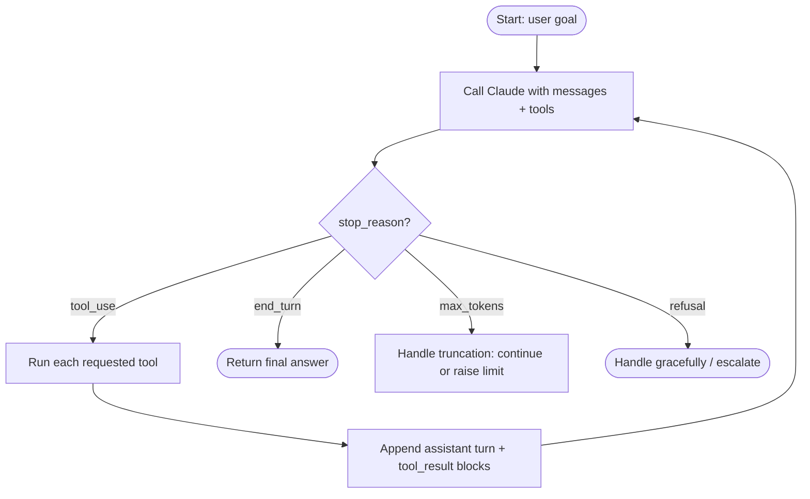

# D1 · Agentic Architecture & Orchestration <span class="level-badge">27%</span>

The largest domain. It tests whether you can build agents that **loop correctly, delegate cleanly, follow business rules deterministically, and always finish**, either resolved or handed to a human.

## What this domain covers

* The agentic loop and `stop_reason` handling
* Coordinator–subagent orchestration and explicit context passing
* Multi-step workflows with enforced prerequisites and structured handoffs
* Hooks (PreToolUse / PostToolUse) for policy enforcement
* Fixed vs dynamic task decomposition
* Session state: resume, fork, or fresh start with a summary

---

## The agentic loop

An agent is simply a loop around the Messages API:



```python
def run_agent(messages, tools, max_iterations=20):
    for _ in range(max_iterations):                       # safety cap
        resp = client.messages.create(model=MODEL, max_tokens=2048,
                                      tools=tools, messages=messages)
        messages.append({"role": "assistant", "content": resp.content})

        if resp.stop_reason == "tool_use":
            results = []
            for block in resp.content:
                if block.type == "tool_use":
                    results.append(execute_tool(block))   # returns a tool_result dict
            messages.append({"role": "user", "content": results})
            continue

        if resp.stop_reason == "end_turn":
            return resp
        # max_tokens, refusal, etc. → handle explicitly
        return handle_other_stop(resp, messages)
    return escalate("iteration limit reached", messages)   # never just give up silently
```

**Key points**

* Decide *continue vs stop* from **`stop_reason`**, never by parsing Claude's prose for phrases like "I'm done".
* Return **every** `tool_use` with a matching `tool_result` (same `tool_use_id`), including failures (`is_error: true`).
* Always keep an **iteration cap**, and treat hitting it as an event that needs handling (escalation), not a silent exit.

---

## Coordinator–subagent orchestration

For complex work, a **coordinator** (orchestrator) splits the task and delegates to **subagents** (hub-and-spoke).

| Why subagents | What to remember |
|---|---|
| **Context isolation**: each subagent burns its own context exploring, and returns only a summary | Subagents do **not** inherit the coordinator's conversation. Pass the needed context **explicitly** in the brief |
| **Specialisation**: own prompt, own tool set, even a different model | Restrict tools per subagent (least privilege, better selection) |
| **Parallelism**: independent subtasks run concurrently | The coordinator owns synthesis, de-duplication and conflict handling |

**A good delegation brief** contains: the objective, the relevant facts already known, scope boundaries, the output format expected back (structured), and what to do if blocked.

!!! warning "Classic trap: decomposition too narrow"
    If the coordinator splits "impact of AI on healthcare" into only "radiology" and "drug discovery", the final report silently misses whole areas. Fix it at the coordinator: have it check **coverage** against the question and spawn follow-up subtasks.

---

## Task decomposition: fixed vs dynamic

| Fixed pipeline (prompt chaining) | Dynamic / adaptive decomposition |
|---|---|
| Steps known in advance: extract → validate → summarise | Steps depend on what is discovered |
| Predictable, easy to test, cheap | Flexible; handles open-ended problems |
| Best for: document processing, well-defined transforms | Best for: research, debugging, investigation |

The exam objective is explicit: for open-ended tasks, **generate subtasks as new information appears** rather than running a fixed list regardless of intermediate findings. Example: an investigation agent finds the bug is in a dependency, not the app, so it creates a new "check dependency changelog" subtask instead of finishing the original plan.

---

## Multi-step workflows & prerequisites

When step B **must** happen after step A (verify identity → refund), don't rely on a prompt saying *"always verify first"*. Enforce it in code:

```python
state = {"customer_verified": False}

def execute_tool(block):
    if block.name == "process_refund" and not state["customer_verified"]:
        return tool_error(block.id, category="precondition",
                          message="Customer not verified. Call verify_customer first.",
                          retryable=True)
    result = TOOLS[block.name](**block.input)
    if block.name == "verify_customer" and result["verified"]:
        state["customer_verified"] = True
    return ok(block.id, result)
```

Options for enforcing order, from most to least deterministic:

1. **Gate in code / PreToolUse hook**: block the dependent tool until the prerequisite is satisfied (see above).
2. **Force the first call** with `tool_choice: {"type":"tool","name":"verify_customer"}`, then switch back to `auto`.
3. **Expose tools progressively**: don't offer `process_refund` until verification has succeeded.
4. Prompt instructions alone: helpful, but **never sufficient** when the order matters.

---

## Guaranteed termination: resolution or escalation

A production agent must never just stop. Every session should end in exactly one of: **resolved** or **escalated to a human**.

Design the guarantee at the **orchestration layer**, outside the model:

```python
outcome = run_agent(messages, tools)

if not (session.resolution_recorded or session.escalation_recorded):
    # loop ended by end_turn without resolving, hit max iterations, errored, or refused
    create_escalation(reason="no resolution recorded",
                      handoff=build_handoff_package(session))
```

This catches every termination path: normal end, iteration cap, exceptions, refusals, timeouts. A `Stop` hook (Claude Code / Agent SDK) can also block the agent from ending until a resolution exists.

---

## Structured handoff packages

When control moves between agents, or to a human, pass a **structured package**, not a raw transcript:

```json
{
  "case_id": "CASE-000123",
  "customer": {"id": "CUST-TEST-01", "verified": true, "verified_by": "otp"},
  "issue_summary": "Duplicate charge on order ORD-10001",
  "facts_established": ["Two charges of the same amount on the same day", "Order shipped once"],
  "actions_taken": [{"tool": "lookup_order", "result": "found"}],
  "authorization_state": {"refund_limit_remaining": 0, "approval_required": true},
  "open_questions": ["Was the second charge a pre-authorisation?"],
  "recommended_next_step": "Approve refund of duplicate charge",
  "escalation_reason": "Refund above agent limit"
}
```

What makes it good: **accumulated findings**, **what was already done** (so nobody repeats it), **authorisation state** (verified? approvals?), and a clear **reason and next step**.

---

## Hooks: deterministic policy enforcement

Hooks are code that runs at fixed points in the agent lifecycle. Prompts are *probabilistic*; hooks are *deterministic*.

| Hook | Runs | Use it to |
|---|---|---|
| **PreToolUse** | before a tool executes | block, allow, or modify the call: policy limits, prerequisites, forbidden paths |
| **PostToolUse** | after a tool succeeds | transform or normalise results, redact PII, run formatters or tests, audit-log |
| **Stop** / SubagentStop | when the agent tries to finish | require a resolution or test run before stopping |
| UserPromptSubmit, SessionStart… | other lifecycle points | inject context, validate input |

Illustrative Agent SDK (Python) PreToolUse hook:

```python
async def refund_policy(input_data, tool_use_id, context):
    amount = input_data["tool_input"].get("amount", 0)
    if amount > 500:
        return {"hookSpecificOutput": {
            "hookEventName": "PreToolUse",
            "permissionDecision": "deny",
            "permissionDecisionReason": "Refunds over 500 need human approval. Escalate."}}
    return {}

options = ClaudeAgentOptions(
    hooks={"PreToolUse": [HookMatcher(matcher="process_refund", hooks=[refund_policy])]})
```

In Claude Code shell hooks, **exit code 2 blocks** a PreToolUse call and sends stderr to Claude as feedback. Exit code 1 does **not** block.

---

## Session state: resume, fork or fresh start

| Option | Use when | Watch out |
|---|---|---|
| **Resume** (`--resume` / `--continue`, SDK `resume`) | continuing the same work soon; context still valid | prior tool results may be **stale** if files changed |
| **Fork** (`fork_session`) | explore an alternative from the same starting point without disturbing the original | both branches diverge; merge results deliberately |
| **Fresh start + summary** | old context is long, noisy or stale | the summary must carry key facts, decisions, and open items |

**Resumption technique (exam objective):** when resuming after the code changed, don't re-analyse everything and don't trust stale results. **Re-analyse only the changed files** (for example via `git diff` since the last session) and **inject a concise context block** of prior findings, so nothing is repeated or lost.

---

!!! practitioner "Practitioner's note: draw the exit paths"
    When reviewing any agent design, list **every** way the loop can end: `end_turn`, the iteration cap, an exception, a refusal, a timeout, a user who goes quiet. Then check each one lands in exactly one of two states: *resolved* or *escalated with a handoff*. The paths nobody drew are where customers get lost, and they're usually what a scenario question is really testing.
    <br>— *Prasoon Abhinaw*

## Anti-patterns & exam traps

| Wrong option sounds like… | Why it's wrong |
|---|---|
| "Check whether Claude's reply contains 'task complete'" | Use `stop_reason`; prose parsing is brittle |
| "Add to the system prompt: always verify before refunding" | Not a guarantee. Use a gate or hook |
| "Let the subagent read the coordinator's full history" | Breaks isolation and floods context. Pass a focused brief |
| "Raise max iterations so the agent always finishes" | Doesn't guarantee resolution. Add an orchestration-level escalation check |
| "Resume and re-run the full analysis" | Wasteful. Do targeted re-analysis of changed files + context injection |
| "One agent with all 25 tools" | Selection degrades. Specialise and scope tools |

## Decision rules

1. **Loop on `stop_reason`**, cap iterations, and escalate on the cap.
2. **Order that matters is enforced in code**, not prose.
3. **Every session ends resolved or escalated**, checked outside the model.
4. **Subagents get explicit, minimal context** and return structured summaries.
5. **Fixed pipelines for predictable work, dynamic decomposition for open-ended work.**
6. **Resume with targeted re-analysis**; start fresh with a summary when context is stale.

## Check yourself

??? question "An agent occasionally ends with a polite message but never logs a resolution or creates a ticket. Most reliable fix?"
    Add an **orchestration-layer check** after the loop: if no resolution or escalation was recorded, create an escalation with a handoff package automatically. Prompt instructions and higher iteration limits don't guarantee this.

??? question "A coordinator's subagent keeps asking for information the coordinator already found. Why?"
    Subagents don't inherit the coordinator's context. The coordinator must pass relevant findings **explicitly** in the delegation brief.

??? question "You resume a code-review session a day later; 3 of 40 files changed. Best approach?"
    Resume with a summary of prior findings injected, and **re-analyse only the 3 changed files**. Don't re-review all 40, and don't trust the stale results for the changed ones.

??? question "Business rule: refunds over a limit must never be issued by the agent. Where does this live?"
    In a **PreToolUse hook** (or equivalent code gate) on the refund tool that denies over-limit calls and routes them for approval.

---

!!! abstract "Verify in official docs"
    Product details change. Before relying on a specific parameter, limit or price, check the current documentation:

    * [Tool use: implement tool use (stop_reason, tool results)](https://platform.claude.com/docs/en/agents-and-tools/tool-use/implement-tool-use)
    * [Agent SDK overview](https://platform.claude.com/docs/en/agent-sdk/overview)
    * [Claude Code hooks reference](https://code.claude.com/docs/en/hooks)
