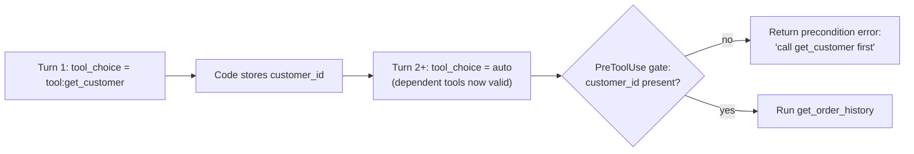

# D2 · Tool Design & MCP Integration <span class="level-badge">18%</span>

Tools are how agents act. This domain tests whether Claude **picks the right tool**, **calls tools in the right order**, **understands tool failures**, and whether MCP servers are **integrated at the right scope, securely**.

## What this domain tests

* Writing tool descriptions that drive correct selection
* Structured, type-specific error responses
* How many tools to give an agent; `tool_choice`; sequencing
* MCP scopes, authentication via env-var expansion, resources, discovery
* Built-in tools: Grep, Glob, Read, Edit

---

## Tool descriptions: the #1 selection signal

Claude chooses tools mainly from their **names and descriptions**. Vague or overlapping descriptions cause misrouting.

=== "❌ Weak"

    ```json
    {"name": "search", "description": "Searches for information."}
    {"name": "lookup", "description": "Looks up data."}
    ```

=== "✅ Strong"

    ```json
    {
      "name": "search_knowledge_base",
      "description": "Full-text search over PUBLISHED help-centre articles. Use for 'how do I…' product questions. Do NOT use for a specific customer's orders or tickets — use lookup_ticket instead. Input: a short natural-language query, e.g. 'reset password'. Returns up to 5 article titles + URLs."
    }
    ```

A strong description has:

1. **What it does** and over what data
2. **When to use it**, with an example
3. **When not to**, naming the alternative tool (disambiguation)
4. **Input format**, with an example value
5. **What it returns**

!!! note "System prompts can skew selection"
    If the system prompt repeatedly says "always search first", Claude may over-call the search tool even when a different tool fits better. Keep tool-selection guidance in the tool descriptions and keep the system prompt neutral.

---

## Structured tool errors

A generic `"Error"` leaves the agent guessing: retry? give up? ask the user? Return **structured, type-specific** information instead.

```json
{
  "type": "tool_result",
  "tool_use_id": "toolu_01A...",
  "is_error": true,
  "content": "{\"error_category\": \"transient\", \"is_retryable\": true, \"message\": \"Order service timed out\", \"suggested_action\": \"Retry once after a short wait; if it fails again, tell the customer you'll follow up.\"}"
}
```

| Category | Example | Agent should… |
|---|---|---|
| **transient** | timeout, rate limit | retry (with backoff, bounded) |
| **validation** | bad order ID format | fix the input and retry |
| **business / policy** | refund window expired | explain to the user or escalate; don't retry |
| **permission** | not authorised | stop that path; escalate |
| **not found vs empty** | no such customer vs customer has no orders | treat differently; "no results" is a valid answer, "couldn't access" is a failure |

!!! danger "Never suppress errors"
    Returning an empty success when a tool failed makes the agent confidently wrong. Always surface the failure with context.

---

## tool_choice and tool sequencing

### Guaranteeing a tool call

| Need | Setting |
|---|---|
| Claude decides | `{"type": "auto"}` |
| Must call *some* tool (no chit-chat) | `{"type": "any"}` |
| Must call *this* tool (e.g. structured output, or a mandatory first step) | `{"type": "tool", "name": "record_extraction"}` |
| No tools this turn | `{"type": "none"}` |

When downstream code **requires** a tool call (a parser expects structured data), a prompt instruction is not enough. **Force it** with `tool_choice`. Remember: forced modes (`any`/`tool`) are not supported with manually enabled extended thinking, and Claude won't write preamble text before the forced call.

### Sequencing multi-tool workflows

Many tasks need data from tool A before tool B can be called correctly (customer ID before order history; schema before query). Ways to guarantee correct order:



1. **Force the prerequisite** in the first turn with `tool_choice: {"type":"tool","name":"get_customer"}`.
2. **Gate dependent tools** in code or a PreToolUse hook; return a structured *precondition* error pointing to the right tool.
3. **Reveal tools progressively**: include the dependent tool in `tools` only once its inputs exist.
4. Make dependencies explicit in descriptions ("Requires customer_id from get_customer").

Also useful: `disable_parallel_tool_use: true` when calls must happen one at a time (otherwise Claude may request A and B in parallel in the same turn).

### How many tools?

Accuracy drops as the tool list grows and overlaps. A focused agent with **4–5 relevant tools** routes better than one with 18+. Split responsibilities across specialised subagents, and give each only its tools (least privilege).

---

## MCP integration

### Scope decision

| Situation | Scope | File |
|---|---|---|
| Whole team needs the same server (issue tracker, internal docs) | **project** | `.mcp.json` in repo root (committed) |
| Personal or experimental server, all your projects | **user** | `~/.claude.json` (top level) |
| Personal, only this project (default for `claude mcp add`) | **local** | `~/.claude.json` (under project path) |

Precedence for same-named servers: **local > project > user**. Project-scope servers prompt each user for approval on first use.

### Authentication

Use **environment-variable expansion**, so tokens never land in Git:

```json
{
  "mcpServers": {
    "tickets": {
      "type": "http",
      "url": "${TICKETS_MCP_URL:-https://mcp.example.internal/mcp}",
      "headers": { "Authorization": "Bearer ${TICKETS_TOKEN}" }
    }
  }
}
```

### Verify discovery

After configuring: `claude mcp list` or `/mcp` in a session. Confirm the server is **connected** and its **tools are listed**. Many "Claude ignores my tool" problems are really "the server never connected" or "the env var wasn't set".

### Resources

Expose a **resource** (for example a catalogue of available documents or a schema) so the agent can read *what exists* in one step instead of making many exploratory tool calls.

---

## Built-in tools (Claude Code / Agent SDK)

| Tool | Use for |
|---|---|
| **Glob** | find files by **name/path pattern** (`src/**/*.test.ts`) |
| **Grep** | find **content** inside files (function names, error strings) |
| **Read** | read a specific file (or part of one) once you know where to look |
| **Edit** | exact string replacement. **Fails if the match isn't unique**: add surrounding context, or Read + Write |
| **Write** | create or fully overwrite a file |
| **Bash** | run commands (tests, builds, git) |

Efficient exploration: **Glob/Grep to locate → Read only the relevant files/sections**. Don't Read the whole repo.

---

## Anti-patterns & exam traps

| Wrong option | Better |
|---|---|
| "Rename the tools" when two tools are confused | Expand **descriptions** with use-cases, formats and disambiguation |
| "Return 'error' and let Claude figure it out" | Structured error with category, retryability, next action |
| "Tell Claude in the prompt to call `get_customer` first" | Force with `tool_choice` and/or gate in code |
| "Give every agent every tool, for flexibility" | Scope tools per agent |
| "Put the API token in `.mcp.json` so it works for everyone" | `${ENV_VAR}` expansion; each person sets their own secret |
| "Configure the team's server at user scope on each laptop" | Project scope `.mcp.json`, committed |

## Decision rules

1. **Descriptions decide selection**: what, when, when-not, input format, output.
2. **Errors are data**: category + retryable + next action; never suppress.
3. **Required call → force `tool_choice`. Required order → force first step and gate the rest.**
4. **Fewer, sharper tools per agent.**
5. **Shared server → project `.mcp.json`; personal → user/local; secrets → `${VAR}`.**
6. **Verify discovery** before debugging prompts.

## Check yourself

??? question "An extraction pipeline sometimes gets a conversational reply instead of a tool call, crashing the parser. Fix?"
    Set `tool_choice` to `{"type":"tool","name":"<extraction_tool>"}` so the tool call is guaranteed.

??? question "Agent calls `get_order_history` with a made-up customer ID before calling `find_customer`. Most reliable fix?"
    Enforce the order: force `find_customer` first (`tool_choice`), and gate `get_order_history` in code/hook so that without a verified customer ID it returns a structured precondition error. Optionally, only expose it after the ID exists.

??? question "A teammate cloned the repo but Claude can't see the shared Jira MCP server. Likely cause?"
    It was configured at **local or user** scope on the original developer's machine. Move it to project scope (`.mcp.json`), with credentials via env-var expansion.
