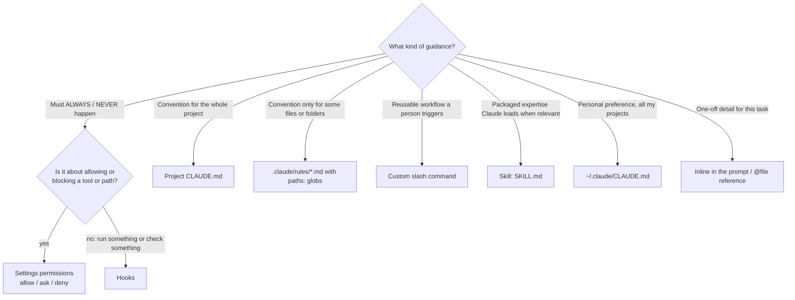

# D3 · Claude Code Configuration & Workflows <span class="level-badge">20%</span>

This domain is about **putting each kind of guidance in the right mechanism at the right scope**, and running effective workflows: plan mode, iterative refinement, codebase exploration and CI.

## What this domain covers

* CLAUDE.md hierarchy, `@` imports, `.claude/rules/` with path globs
* Custom slash commands and Skills (project vs personal)
* Advice (CLAUDE.md) vs enforcement (hooks, permissions)
* Plan mode vs direct execution
* Iterative refinement techniques
* Codebase exploration and CI/CD usage

---

## Choosing the right mechanism



| Guidance | Mechanism | Scope |
|---|---|---|
| "Use pnpm, not npm" (team convention) | Project `CLAUDE.md` | committed |
| "API handlers must validate input with zod" (only `src/api/**`) | `.claude/rules/api.md` with `paths: ["src/api/**/*.ts"]` | committed |
| "Never read `.env` files" | **permissions deny** `Read(./.env)` | `.claude/settings.json` |
| "Format every edited file with Prettier" | **PostToolUse hook** on Edit/Write | `.claude/settings.json` |
| "Block `rm -rf` and pushes to main" | **PreToolUse hook** and/or permissions deny | settings |
| "Our PR review checklist" invoked on demand | `.claude/commands/review-pr.md` | committed |
| "I like terse answers" | `~/.claude/CLAUDE.md` | personal |
| "My local API key / sandbox URL" | `.claude/settings.local.json` | personal, git-ignored |

---

## Advice vs enforcement

!!! tip "CLAUDE.md is read by the model, so it is *likely* to be followed. Hooks and permissions are executed by the harness, so they are *guaranteed*."

Restructuring exercise (a common exam style): a CLAUDE.md contains

```markdown
- Use 2-space indentation and run prettier after editing      ← enforcement → PostToolUse hook
- Never modify files in /migrations                           ← enforcement → permissions deny Edit(./migrations/**)
- Prefer composition over inheritance in React components     ← advice → stays in CLAUDE.md (or a rule for src/components/**)
- Never run `git push --force`                                ← enforcement → permissions deny / PreToolUse hook
```

Move the **must/never** items into settings or hooks; keep **judgement and style** guidance in CLAUDE.md or rules.

---

## CLAUDE.md hierarchy & rules

| Level | Location | Shared? |
|---|---|---|
| Enterprise / managed | OS-level managed policy location | org-wide |
| User | `~/.claude/CLAUDE.md` | personal, all projects |
| Project | `./CLAUDE.md` or `./.claude/CLAUDE.md` | team (committed) |
| Sub-directory | `./packages/api/CLAUDE.md` | loaded when Claude works in that folder |

* **Imports:** `@docs/architecture.md` inside CLAUDE.md pulls another file in, so you can keep CLAUDE.md short and modular.
* **Rules:** `.claude/rules/*.md` hold topic-specific instructions. Add YAML frontmatter with `paths:` globs so a rule loads **only** when Claude works on matching files:

```markdown
---
paths:
  - "src/api/**/*.ts"
---
# API rules
- Validate every request body with zod before use.
- Return errors as { code, message } objects.
```

Why path rules? They keep context lean (irrelevant rules aren't loaded) and apply precisely where needed.

---

## Providing context: @ references vs CLAUDE.md vs inline

| Method | Best when |
|---|---|
| **CLAUDE.md** | the info is needed **across many sessions** and by the whole team (build commands, architecture) |
| **`@path/to/file`** in your prompt | a **specific file** is relevant to **this task** (precise and current, not permanently loaded) |
| **Inline description** | a **one-off** detail for this request only |

Don't stuff task-specific details into CLAUDE.md. It loads every session and wastes context.

---

## Custom slash commands and Skills

**Commands** are saved prompts that a person invokes by typing `/name`.

| Location | Who gets it | Invoked as |
|---|---|---|
| `.claude/commands/review-pr.md` | everyone who clones the repo | `/review-pr` |
| `~/.claude/commands/standup.md` | only you, every project | `/standup` |

```markdown
---
description: Review the current branch against our checklist
argument-hint: [focus-area]
allowed-tools: Bash(git diff:*), Read, Grep
---
Review the changes in `git diff main...HEAD`, focusing on $ARGUMENTS.
Check: tests added, no secrets, error handling, naming conventions.
Output a table of findings with severity.
```

**Skills** live in `.claude/skills/<name>/SKILL.md` (or `~/.claude/skills/`). Their **description** tells Claude when to load them automatically, and they can bundle scripts and reference files. Frontmatter options worth knowing: `allowed-tools` restricts what the skill may use, `argument-hint` tells the user what input it expects, and `context: fork` runs the skill in an isolated sub-agent context so that verbose output stays out of the main conversation. In recent Claude Code versions, commands and skills are converging; `.claude/commands/` files keep working.

!!! question "Command or skill?"
    * Person decides when → **command**.
    * Claude should pick it up when the task matches, and it needs bundled resources → **skill**.

---

## Plan mode vs direct execution

| Use **plan mode** when… | Use **direct execution** when… |
|---|---|
| the change spans many files or modules | a small, clearly scoped change (fix a typo, rename a variable) |
| the architecture or approach is uncertain | the approach is obvious |
| the change is hard to reverse (migrations, deletions, public APIs) | the change is easily reverted |
| stakeholders should review before code is written | no review is needed |

Toggle with ++shift+tab++ (cycles permission modes) or start with `--permission-mode plan`.

---

## Hooks for code quality

Run formatters, linters or tests **after every edit**, independent of whether Claude "remembers" to.

```json title=".claude/settings.json"
{
  "hooks": {
    "PostToolUse": [
      {
        "matcher": "Edit|Write",
        "hooks": [
          { "type": "command", "command": "\"$CLAUDE_PROJECT_DIR\"/.claude/hooks/format-and-lint.sh" }
        ]
      }
    ]
  }
}
```

```bash title=".claude/hooks/format-and-lint.sh"
#!/usr/bin/env bash
# Reads the hook JSON on stdin, formats the edited file, and reports lint errors back to Claude.
file=$(jq -r '.tool_input.file_path // empty')
[ -z "$file" ] && exit 0
npx prettier --write "$file" >/dev/null 2>&1
if ! npx eslint "$file" 1>&2; then
  exit 2   # stderr (the lint errors) is shown to Claude so it can fix them
fi
exit 0
```

Exit code semantics: **0** = success · **2** = blocking error, stderr goes to Claude · other = non-blocking error. For PostToolUse the edit has already happened, so exit 2 *feeds back* the problem rather than undoing it.

---

## Iterative refinement

When output isn't right, make your feedback **specific and testable**:

1. **Concrete input → expected output examples** ("Given `2024-3-5`, output `2024-03-05`").
2. **Test-driven iteration**: write or point at failing tests and ask Claude to make them pass.
3. **Targeted feedback**: name the exact failure ("row 3 drops the currency symbol") rather than "it's still wrong".
4. **Batch related issues** into one message when they **interact** (fixing one affects the others), so they are evaluated together. Handle **independent** issues one by one.
5. **Interview pattern**: ask Claude to ask *you* clarifying questions before it implements.

---

## Exploring a codebase systematically

1. Start broad: **Glob** for structure (`**/*.py`), read README / CLAUDE.md.
2. Narrow with **Grep** for the symbol, route or error string.
3. **Read** only the relevant files or sections.
4. Record findings in a **scratchpad file** (`notes/exploration.md`) so they survive `/compact` or a new session.
5. Delegate broad searches to a **subagent** (for example the Explore agent) so your main context stays clean.

---

## Claude Code in CI/CD

```bash
claude -p "Review this PR diff for security issues. Output JSON findings." \
  --output-format json > review.json
```

* `-p` (print mode): non-interactive; nothing waits for keyboard input.
* `--output-format json`: machine-parseable output for the pipeline. Add `--json-schema` to have the final result validated against a schema you supply, so the next step can rely on its shape.
* **Give the reviewer what already exists.** Include the existing tests so it doesn't suggest duplicates, and on a re-review include the earlier findings so it reports only new or unresolved issues.
* Put review criteria, testing standards and fixture conventions in `CLAUDE.md`, so a CI-invoked run has the same project context as a developer.
* Use a **separate, fresh session** for review rather than the one that generated the code (independent review).
* Lock it down: restrict allowed tools in CI settings and inject secrets via the CI's secret store.

---

!!! practitioner "Practitioner's note: the 'should or must?' audit"
    Go through your CLAUDE.md one line at a time and ask a single question: **is this a *should* or a *must*?** Every *must* (never read secrets, always format, never push to main) moves into permissions or a hook. Every *should* stays in memory or becomes a path-scoped rule. After that audit, the file is usually shorter, clearer and far more reliable.
    <br>— *Prasoon Abhinaw*

## Anti-patterns & exam traps

| Wrong option | Better |
|---|---|
| "Add 'ALWAYS run prettier' to CLAUDE.md in caps" | PostToolUse hook |
| "Put API-folder rules in the root CLAUDE.md" | `.claude/rules/` with `paths:` glob |
| "Save the team command in `~/.claude/commands/`" | `.claude/commands/` (committed) |
| "Put your personal API key in `.claude/settings.json`" | `.claude/settings.local.json` or env var |
| "Use plan mode for every change" | Only for broad, uncertain or irreversible changes |
| "Run Claude Code interactively in CI" | `-p` + JSON output |

## Decision rules

1. **Must / never → hooks or permissions. Should / prefer → CLAUDE.md or rules.**
2. **Path-specific guidance → `.claude/rules/` with globs.**
3. **Team assets → project `.claude/…` (committed). Personal → `~/.claude/…` or `*.local.json`.**
4. **Cross-session, team-wide context → CLAUDE.md; task-specific file → `@` reference; one-off → inline.**
5. **Plan mode for scope, uncertainty, irreversibility, or review.**
6. **CI → `-p` + structured output + independent review session.**

## Check yourself

??? question "Developers keep forgetting to run tests; Claude sometimes does too. How do you guarantee tests run after code edits?"
    A **PostToolUse hook** matching Edit/Write that runs the test command (or a Stop hook that blocks finishing until tests pass). A CLAUDE.md reminder isn't a guarantee.

??? question "A rule should apply only to Terraform files in `infra/`. Where?"
    `.claude/rules/terraform.md` with frontmatter `paths: ["infra/**/*.tf"]`.

??? question "You want a `/release-notes` command available to every engineer who clones the repo."
    Create `.claude/commands/release-notes.md` and commit it.

---

!!! abstract "Verify in official docs"
    Product details change. Before relying on a specific parameter, limit or price, check the current documentation:

    * [Claude Code documentation](https://code.claude.com/docs)
    * [Claude Code hooks reference](https://code.claude.com/docs/en/hooks)
