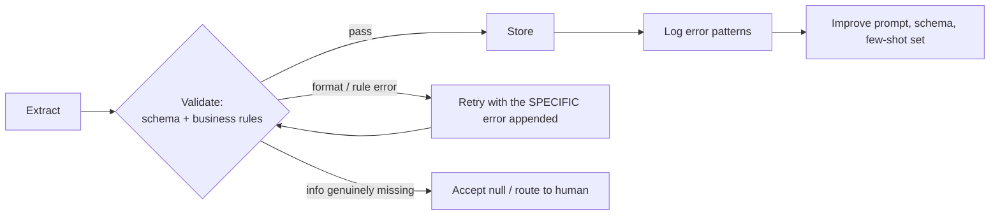

# D4 · Prompt Engineering & Structured Output <span class="level-badge">20%</span>

This domain tests how you get **consistent, valid, honest output**: clear criteria, few-shot examples, schemas that don't force guesses, retry loops that actually help, the right processing mode, and independent review.

## What this domain tests

* Explicit, categorical criteria
* Few-shot prompting for format and ambiguous cases
* Structured output: tool use + JSON schema + `tool_choice`
* Schema design (optional, nullable, enums) that prevents fabrication
* Validation/retry loops and feedback loops
* Synchronous vs Message Batches API
* Multi-instance (independent) review

---

## Explicit criteria beat vague instructions

| ❌ Vague | ✅ Explicit and categorical |
|---|---|
| "Be conservative when flagging transactions." | "Flag a transaction if ANY of: amount > 10,000; country not in the customer's history; 3+ transactions within 10 minutes." |
| "Only report important bugs." | "Report: security issues, data loss, crashes, incorrect results. Do NOT report: style, naming, missing comments." |
| "Skip low-confidence items." | Define **categories** for what to include/exclude; self-reported confidence is poorly calibrated |

Categorical criteria are testable and consistent. Words like "conservative", "important" and "relevant" are interpreted differently on every run.

---

## Few-shot examples

Few-shot examples are the most effective way to get a **consistent format** and to teach **judgement on ambiguous cases**.

Good few-shot sets:

* Cover **varied document structures** (table invoice, free-text invoice, scanned receipt), not three near-identical examples.
* Include **ambiguous / edge cases with the reasoning** for the chosen output.
* Show **missing data handled correctly** (the field is `null`, not invented).
* Demonstrate **normalisation** (dates to ISO 8601, amounts as numbers with a currency code).

```xml
<example>
  <document>Invoice no. 7781 · Date: 5 Mar 2026 · Total due: €1.240,50 · (no PO number)</document>
  <output>{"invoice_number": "7781", "invoice_date": "2026-03-05",
           "total": 1240.50, "currency": "EUR", "po_number": null}</output>
  <why>European decimal comma normalised; PO number absent so null, not guessed.</why>
</example>
```

---

## Choosing a structured-output method

| Method | Schema compliance | Use when |
|---|---|---|
| Prompt-based ("respond in JSON like…") | lowest; may drift or add prose | prototypes, low stakes |
| Prefill the assistant reply (e.g. start with `{`) | better format adherence; still unvalidated | lightweight formatting nudges (not available with every feature) |
| **Tool use with a JSON schema + forced `tool_choice`** | **highest**: always a tool call with schema-shaped input | production pipelines where parsers depend on it |
| Strict / constrained structured outputs (where supported) | guaranteed schema validity | strict compliance requirements |

The exam pattern: **"strict compliance required, downstream system parses it"** → define a tool whose `input_schema` is your output schema, and **force** it with `tool_choice: {"type": "tool", "name": "..."}`.

```python
extract_tool = {
  "name": "record_invoice",
  "description": "Record the fields extracted from one invoice.",
  "input_schema": INVOICE_SCHEMA,
}
resp = client.messages.create(model=MODEL, max_tokens=1024,
    tools=[extract_tool],
    tool_choice={"type": "tool", "name": "record_invoice"},
    messages=[{"role": "user", "content": document_text}])
data = next(b.input for b in resp.content if b.type == "tool_use")
```

!!! warning "Schemas fix syntax, not truth"
    A schema guarantees *shape* (valid JSON, right types). It does **not** guarantee the values are correct or real. That's what schema design, few-shot examples, validation and review are for.

---

## Schema design that prevents fabrication

If a field is **required** and the document doesn't contain it, the model is pushed to **invent** something. Design the schema so "missing" and "ambiguous" are valid answers.

```json
{
  "type": "object",
  "properties": {
    "invoice_number": {"type": "string"},
    "invoice_date":   {"type": ["string", "null"], "description": "ISO 8601 date, or null if not present"},
    "po_number":      {"type": ["string", "null"], "description": "null if the document has no PO number. Never guess."},
    "total":          {"type": ["number", "null"]},
    "currency":       {"type": ["string", "null"], "enum": ["USD", "EUR", "INR", "GBP", null]},
    "payment_terms":  {"type": "string", "enum": ["net_30", "net_60", "due_on_receipt", "other", "not_stated"]},
    "payment_terms_other": {"type": ["string", "null"], "description": "Only when payment_terms is 'other'"},
    "field_confidence": {
      "type": "object",
      "description": "Per-field confidence: high | medium | low",
      "additionalProperties": {"type": "string", "enum": ["high", "medium", "low"]}
    }
  },
  "required": ["invoice_number", "payment_terms"]
}
```

Design checklist:

* **Required** only for fields that *every* valid document has.
* **Nullable** (`["string","null"]`) for fields that may be absent, with a description saying "null if absent, never guess".
* **Enums** for closed sets, plus an explicit **`not_stated` / `unknown`** value, and an **`other` + free-text** escape hatch, so the model never forces a bad fit.
* Optional **per-field confidence** or an `ambiguity_note`, to drive [human review routing](d5-context-reliability.md#human-review-routing).

---

## Validation, retry and feedback loops



* On retry, **append the exact validation error** ("`invoice_date` '2026-13-02' is not a valid date"). A bare "try again" helps little.
* **Retries cannot create missing information.** If the document doesn't have the PO number, retrying only encourages fabrication. Accept `null` or route to review.
* Bound retries (for example 2), then escalate.
* **Feedback loop:** log structured metadata on each error (field, error type, document type, a `detected_pattern` such as "European decimal format"). Review the patterns periodically and fix the root cause in the prompt, schema or few-shot examples.

---

## Batch vs synchronous

| Choose **Messages API (sync)** when | Choose **Message Batches API** when |
|---|---|
| a user or a blocking workflow step is waiting | nothing is waiting: overnight jobs, back-fills, evals |
| latency matters | throughput and **~50% lower cost** matter |
| you need multi-turn tool loops interactively | each request is self-contained (one batch request can't do an interactive tool round trip with your code) |

Batches complete within **24 hours** (often much sooner). Give each request a **`custom_id`** so you can match results to source records, because results aren't guaranteed to come back in order.

---

## Multi-instance (independent) review

A model reviewing **its own output in the same context** tends to agree with itself. More effective:

* An **independent instance** (fresh context, its own reviewer prompt) checks the work.
* For large changes: **per-file review passes** plus a **cross-file integration pass** (interfaces, consistency).
* Give the reviewer explicit criteria (see above), not "check if it's good".

---

## Anti-patterns & exam traps

| Wrong option | Better |
|---|---|
| "Ask Claude to output only JSON" for a strict parser | Tool + schema + forced `tool_choice` |
| "Make every field required for completeness" | Nullable/optional + `unknown` enums |
| "Retry until the field is filled" | Retry only on format errors; missing stays `null` |
| "Filter results where Claude says confidence < 0.8" | Categorical criteria; calibrated, field-level review |
| "Use the Batch API for the live chat assistant" | Synchronous for anything someone is waiting on |
| "Ask the generator to double-check its work" | Independent reviewer instance |

## Decision rules

1. **Vague words → explicit, categorical criteria.**
2. **Consistency → few-shot with varied formats and edge cases.**
3. **Strict structure → tool schema + forced `tool_choice`.**
4. **Never force a guess: nullable fields, `unknown` enums, `other` + detail.**
5. **Retry with the specific error; never retry missing information.**
6. **Waiting → sync; bulk and non-urgent → batch with `custom_id`.**
7. **Review with a fresh, independent instance.**

## Check yourself

??? question "Extraction fills `po_number` with plausible-looking values on documents that have none. Best fix?"
    Make `po_number` **nullable** (not required), describe "null if absent, never guess", and include a few-shot example with a missing PO → `null`.

??? question "Validation fails because a date is 'March 5th'. What should the retry contain?"
    The specific error ("`invoice_date` must be ISO 8601 YYYY-MM-DD; got 'March 5th'"), plus the original document. Better still, add a normalisation instruction and an example so it doesn't happen again.

??? question "Weekly re-scoring of 200k historical records. API mode?"
    **Message Batches API**: not time-sensitive, high volume, about 50% cheaper. Correlate via `custom_id`.
