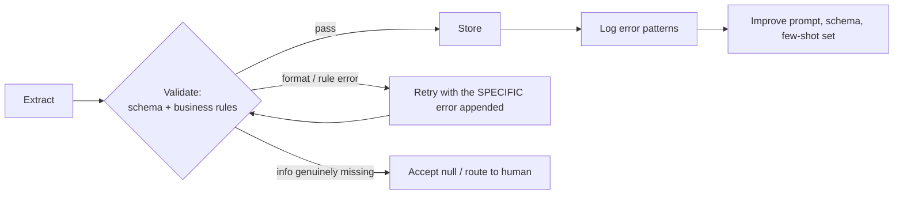

# D4 · Prompt Engineering & Structured Output <span class="level-badge">20%</span>

This domain tests how you get **consistent, valid, honest output**: clear criteria, few-shot examples, schemas that don't force guesses, retry loops that actually help, the right processing mode, and independent review.

## What this domain covers

* Explicit, categorical criteria
* Few-shot prompting for format and ambiguous cases
* Structured output: tool use + JSON schema + `tool_choice`
* Schema design (optional, nullable, enums) that prevents fabrication
* Validation/retry loops and feedback loops
* Synchronous vs Message Batches API, and batch limits
* Prompt caching: what to cache, TTLs and pitfalls
* Multi-instance (independent) review

---

## Explicit criteria beat vague instructions

| ❌ Vague | ✅ Explicit and categorical |
|---|---|
| "Be conservative when flagging transactions." | "Flag a transaction if ANY of: amount > 10,000; country not in the customer's history; 3+ transactions within 10 minutes." |
| "Only report important bugs." | "Report: security issues, data loss, crashes, incorrect results. Do NOT report: style, naming, missing comments." |
| "Skip low-confidence items." | Define **categories** for what to include/exclude; self-reported confidence is poorly calibrated |

Categorical criteria are testable and consistent. Words like "conservative", "important" and "relevant" are interpreted differently on every run.

---

## Few-shot examples

Few-shot examples are the most effective way to get a **consistent format** and to teach **judgement on ambiguous cases**.

Good few-shot sets:

* Cover **varied document structures** (table invoice, free-text invoice, scanned receipt), not three near-identical examples.
* Include **ambiguous / edge cases with the reasoning** for the chosen output.
* Show **missing data handled correctly** (the field is `null`, not invented).
* Demonstrate **normalisation** (dates to ISO 8601, amounts as numbers with a currency code).

```xml
<example>
  <document>Invoice no. 7781 · Date: 5 Mar 2026 · Total due: €1.240,50 · (no PO number)</document>
  <output>{"invoice_number": "7781", "invoice_date": "2026-03-05",
           "total": 1240.50, "currency": "EUR", "po_number": null}</output>
  <why>European decimal comma normalised; PO number absent so null, not guessed.</why>
</example>
```

---

## Choosing a structured-output method

| Method | Schema compliance | Use when |
|---|---|---|
| Prompt-based ("respond in JSON like…") | lowest; may drift or add prose | prototypes, low stakes |
| Prefill the assistant reply (e.g. start with `{`) | better adherence; still unvalidated | lightweight nudges (not compatible with every feature, e.g. JSON outputs mode) |
| **Tool use with a JSON schema + forced `tool_choice`** | **high**: always a tool call shaped by the schema | the classic, widely supported pattern for production pipelines |
| **Native structured outputs** (see below) | **guaranteed** schema-valid output (grammar-constrained) | strict compliance on models that support it |

### Native structured outputs

The Claude API also offers **structured outputs** with two complementary features:

| Feature | Parameter | Controls | Use when |
|---|---|---|---|
| **JSON outputs** | `output_config.format` with `type: "json_schema"` | the shape of Claude's **final response** | pure extraction, classification, structured reports |
| **Strict tool use** | `"strict": true` on a tool definition | the **tool name and inputs** Claude produces | agents whose tool calls must always validate |

They can be used **together**: JSON outputs for what Claude says, strict tool use for how it calls your functions. (Earlier beta versions used an `output_format` parameter and a beta header; check the current docs for the exact shape.)

Points to remember:

* **Guaranteed format ≠ guaranteed truth.** Values can still be wrong or invented. Schema design, examples and review still matter.
* Some features don't combine, for example **prefill with JSON outputs**. Check the compatibility notes before mixing features.
* JSON Schema support has limitations (not every keyword is supported). Keep schemas simple and flat where you can.

The classic scenario pattern: **"strict compliance required, downstream system parses it"** → define a tool whose `input_schema` is your output schema and **force** it with `tool_choice: {"type": "tool", "name": "..."}`, or use native structured outputs where available. Both beat "ask for JSON in the prompt".

```python
extract_tool = {
  "name": "record_invoice",
  "description": "Record the fields extracted from one invoice.",
  "input_schema": INVOICE_SCHEMA,
}
resp = client.messages.create(model=MODEL, max_tokens=1024,
    tools=[extract_tool],
    tool_choice={"type": "tool", "name": "record_invoice"},
    messages=[{"role": "user", "content": document_text}])
data = next(b.input for b in resp.content if b.type == "tool_use")
```

!!! warning "Schemas fix syntax, not truth"
    A schema guarantees *shape* (valid JSON, right types). It does **not** guarantee the values are correct or real. That's what schema design, few-shot examples, validation and review are for.

---

## Schema design that prevents fabrication

If a field is **required** and the document doesn't contain it, the model is pushed to **invent** something. Design the schema so "missing" and "ambiguous" are valid answers.

```json
{
  "type": "object",
  "properties": {
    "invoice_number": {"type": "string"},
    "invoice_date":   {"type": ["string", "null"], "description": "ISO 8601 date, or null if not present"},
    "po_number":      {"type": ["string", "null"], "description": "null if the document has no PO number. Never guess."},
    "total":          {"type": ["number", "null"]},
    "currency":       {"type": ["string", "null"], "enum": ["USD", "EUR", "INR", "GBP", null]},
    "payment_terms":  {"type": "string", "enum": ["net_30", "net_60", "due_on_receipt", "other", "not_stated"]},
    "payment_terms_other": {"type": ["string", "null"], "description": "Only when payment_terms is 'other'"},
    "field_confidence": {
      "type": "object",
      "description": "Per-field confidence: high | medium | low",
      "additionalProperties": {"type": "string", "enum": ["high", "medium", "low"]}
    }
  },
  "required": ["invoice_number", "payment_terms"]
}
```

Design checklist:

* **Required** only for fields that *every* valid document has.
* **Nullable** (`["string","null"]`) for fields that may be absent, with a description saying "null if absent, never guess".
* **Enums** for closed sets, plus an explicit **`not_stated` / `unknown`** value, and an **`other` + free-text** escape hatch, so the model never forces a bad fit.
* Optional **per-field confidence** or an `ambiguity_note`, to drive [human review routing](d5-context-reliability.md#human-review-routing).

---

## Validation, retry and feedback loops



* On retry, **append the exact validation error** ("`invoice_date` '2026-13-02' is not a valid date"). A bare "try again" helps little.
* **Retries cannot create missing information.** If the document doesn't have the PO number, retrying only encourages fabrication. Accept `null` or route to review.
* Bound retries (for example 2), then escalate.
* **Feedback loop:** log structured metadata on each error (field, error type, document type, a `detected_pattern` such as "European decimal format"). Review the patterns periodically and fix the root cause in the prompt, schema or few-shot examples.

---

## Batch vs synchronous

| Choose **Messages API (sync)** when | Choose **Message Batches API** when |
|---|---|
| a user or a blocking workflow step is waiting | nothing is waiting: overnight jobs, back-fills, evaluations |
| latency matters | throughput and **50% lower cost** matter |
| your code must run tools and reply within the same task | each request is independent and complete on its own |

### Message Batches: numbers worth knowing

| Fact | Value |
|---|---|
| Cost | **50%** of standard prices |
| Size limit per batch | **100,000 requests or 256 MB**, whichever comes first |
| Processing time | most batches finish **within 1 hour**; anything unfinished **expires after 24 hours** |
| Result availability | **29 days** after the batch is created |
| Result order | **not guaranteed**: match results with your **`custom_id`** |
| Per-request outcome | each request succeeds, errors, is canceled or expires **independently** |

Design implications:

* Make `custom_id` meaningful (for example the document's record ID), so results can always be joined back.
* Requests are processed independently, so a batch suits **single-shot** work. An agent loop where your code runs tools between turns doesn't fit.
* Plan for partial failure: re-submit only the errored or expired items.
* Since batches can take longer than 5 minutes, shared-context batches benefit from the **1-hour cache** (see below).

---

## Prompt caching

**Prompt caching** lets requests that share a long, identical **prefix** (tools, system prompt, reference documents, earlier conversation) reuse it instead of re-processing it, which cuts cost and latency.

### How it works

* Caching applies to the prompt **prefix** in this order: **tools → system → messages**, up to a marked point.
* Mark the end of the reusable part with `cache_control: {"type": "ephemeral"}`, or use **automatic caching**, which moves the breakpoint along as a conversation grows.
* **Anything that changes before the breakpoint breaks the cache.** Put stable content first and variable content (the user's question) last.

```python
resp = client.messages.create(
    model=MODEL, max_tokens=1024,
    system=[{
        "type": "text",
        "text": LONG_POLICY_MANUAL,                  # stable, reused on every request
        "cache_control": {"type": "ephemeral"},      # 5-minute TTL by default
    }],
    messages=[{"role": "user", "content": question}],   # changes every time: after the breakpoint
)
print(resp.usage)   # cache_creation_input_tokens / cache_read_input_tokens show writes and hits
```

### Numbers worth knowing

| Fact | Value |
|---|---|
| Default lifetime (TTL) | **5 minutes**, refreshed each time the cache is hit |
| Extended lifetime | **1 hour**: `{"type": "ephemeral", "ttl": "1h"}` |
| Cache **write** price | **1.25×** base input (5-min) · **2×** base input (1-hour) |
| Cache **read** price | **0.1×** base input |
| Explicit breakpoints | up to **4** per request |
| Minimum cacheable length | depends on the model; **shorter prefixes silently don't cache** |

### Design rules

* Use caching when the **same large prefix** is reused often: long system prompts, tool catalogues, a document many questions are asked about, long agent conversations.
* Pick the TTL by the **gap between requests**: frequent traffic → 5 minutes; requests minutes-to-an-hour apart, or batches → 1 hour.
* Keep the cached prefix **byte-for-byte identical**: no timestamps or per-user IDs inside it. Changing tool definitions or `tool_choice` can also invalidate parts of the cache.
* Verify with the `usage` fields. If `cache_read_input_tokens` stays at 0, something before the breakpoint is changing, or the prefix is too short.

!!! tip "Caching vs batching"
    They solve different problems and can be combined: **caching** reuses a shared prefix (good for repeated context); **batching** trades latency for a 50% discount (good for non-urgent volume).

---

## Multi-instance (independent) review

A model reviewing **its own output in the same context** tends to agree with itself. More effective:

* An **independent instance** (fresh context, its own reviewer prompt) checks the work.
* For large changes: **per-file review passes** plus a **cross-file integration pass** (interfaces, consistency).
* Give the reviewer explicit criteria (see above), not "check if it's good".

---

## Anti-patterns & exam traps

| Wrong option | Better |
|---|---|
| "Ask Claude to output only JSON" for a strict parser | Tool + schema + forced `tool_choice` |
| "Make every field required for completeness" | Nullable/optional + `unknown` enums |
| "Retry until the field is filled" | Retry only on format errors; missing stays `null` |
| "Filter results where Claude says confidence < 0.8" | Categorical criteria; calibrated, field-level review |
| "Use the Batch API for the live chat assistant" | Synchronous for anything someone is waiting on |
| "Ask the generator to double-check its work" | Independent reviewer instance |

## Decision rules

1. **Vague words → explicit, categorical criteria.**
2. **Consistency → few-shot with varied formats and edge cases.**
3. **Strict structure → tool schema + forced `tool_choice`.**
4. **Never force a guess: nullable fields, `unknown` enums, `other` + detail.**
5. **Retry with the specific error; never retry missing information.**
6. **Waiting → sync; bulk and non-urgent → batch with `custom_id`.**
7. **Review with a fresh, independent instance.**
8. **Repeated large prefix → cache it; keep it identical; choose the TTL by request gap.**

## Check yourself

??? question "Extraction fills `po_number` with plausible-looking values on documents that have none. Best fix?"
    Make `po_number` **nullable** (not required), describe "null if absent, never guess", and include a few-shot example with a missing PO → `null`.

??? question "Validation fails because a date is 'March 5th'. What should the retry contain?"
    The specific error ("`invoice_date` must be ISO 8601 YYYY-MM-DD; got 'March 5th'"), plus the original document. Better still, add a normalisation instruction and an example so it doesn't happen again.

??? question "Weekly re-scoring of 200k historical records. API mode?"
    **Message Batches API**: not time-sensitive, high volume, about 50% cheaper. Correlate via `custom_id`.

??? question "A support bot sends the same 30-page policy manual as the system prompt with every question, and cache reads stay at zero. The system prompt starts with today's date and time. What's wrong?"
    The timestamp at the **start** of the prefix changes on every request, so the cached prefix never matches. Move variable content after the cache breakpoint (or out of the system prompt) so the manual is byte-for-byte identical each time.

??? question "A nightly batch of 5,000 requests shares one long instruction block. Which cache TTL fits better?"
    The **1-hour** TTL. Batch processing can take longer than 5 minutes, so the default TTL may expire between requests that share the prefix.

---

!!! abstract "Verify in official docs"
    Product details change. Before relying on a specific parameter, limit or price, check the current documentation:

    * [Structured outputs](https://platform.claude.com/docs/en/build-with-claude/structured-outputs)
    * [Prompt caching](https://platform.claude.com/docs/en/build-with-claude/prompt-caching)
    * [Batch processing](https://platform.claude.com/docs/en/build-with-claude/batch-processing)
    * [Prompt engineering overview](https://docs.claude.com/en/docs/build-with-claude/prompt-engineering/overview)
