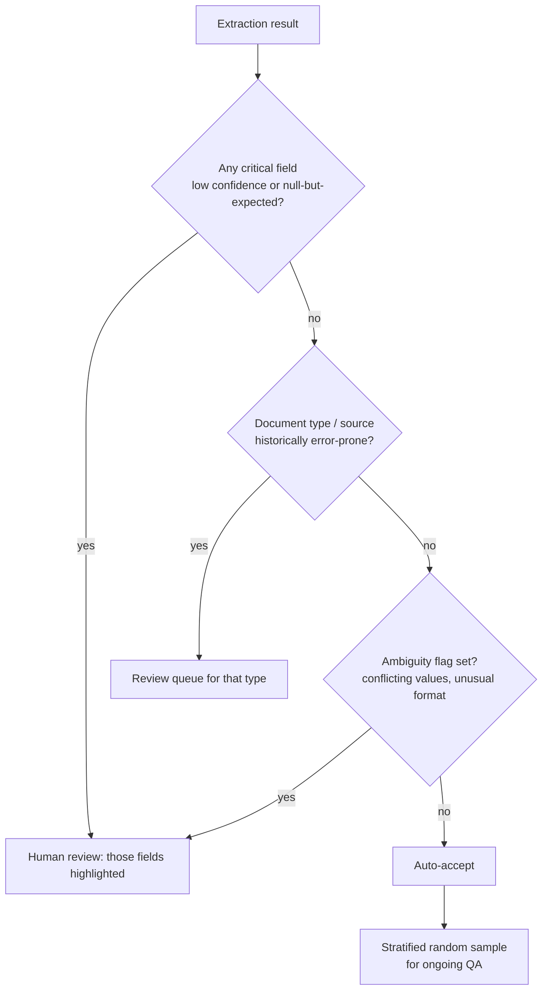

# D5 · Context Management & Reliability <span class="level-badge">15%</span>

The smallest domain by weight, but its ideas show up inside almost every scenario. It tests whether long-running work **stays coherent**, whether agents **escalate at the right time**, whether **errors are propagated honestly**, and whether **human review is targeted where it matters**.

## What this domain covers

* Preserving critical context (summarisation risks, lost-in-the-middle, case-facts blocks)
* Escalation decisions
* Error propagation
* Large codebases and long sessions
* Human review routing and sampling
* Information provenance

---

## Context preservation

Context degrades in three common ways:

| Risk | What happens | Mitigation |
|---|---|---|
| **Progressive summarisation** | each summary drops details; after a few rounds, key facts (amounts, IDs, dates) vanish | keep a **case-facts block**: a compact, structured list of must-keep facts carried verbatim into every turn |
| **Lost in the middle** | facts buried mid-context are under-used | put critical facts at the **start or end**; keep the case-facts block near the end of the prompt |
| **Tool-result accumulation** | raw tool outputs (logs, JSON, pages) flood the window | **trim or summarise tool results** before appending; keep only what's needed; delegate bulky reads to subagents |

```text
<case_facts>
customer_id: CUST-TEST-01 (verified via OTP)
order_id: ORD-10001 · amount: 2,499 INR · charged twice on 2026-10-02
customer_request: refund duplicate charge
policy: agent refund limit 2,000 INR → approval required
</case_facts>
```

---

## Escalation decisions

| Situation | Action |
|---|---|
| Customer **explicitly asks for a human** | **Escalate immediately**. Don't attempt "one more fix" first |
| Request falls in a **policy gap** (no rule covers it) | Escalate; don't improvise policy |
| **No progress** after reasonable attempts / repeated failures | Escalate with a handoff package |
| Action exceeds **authorisation** (amount, permission) | Escalate / route for approval |
| Issue is routine and resolvable with available tools | Attempt autonomous resolution |

!!! warning "Sentiment is not a reliable trigger"
    Frustrated tone does not by itself mean "escalate", and polite tone doesn't mean "fine". Base escalation on **explicit requests, policy, authority and progress**, not mood detection.

---

## Error propagation

* Keep **structured error context** as errors flow from subagent → coordinator → user (what failed, where, retryable?).
* Distinguish **"could not access"** from **"accessed, found nothing"**. Reporting a failed database call as "no records" is a serious correctness bug.
* **Never suppress** errors to make output look clean. Partial results should be labelled as partial.

---

## Long-running work and large codebases

| Technique | What it does |
|---|---|
| **Subagent isolation** | exploration happens in a separate context; only a summary returns |
| **Scratchpad / notes files** | durable findings that survive `/compact`, crashes and new sessions |
| **Targeted reading** | Grep/Glob to locate, then Read only the relevant parts |
| **`/compact`** | summarise the conversation when context grows; pair it with notes so details aren't lost |
| **State exports** | periodically write progress (done / pending / decisions) to a file for crash recovery and resumption |

---

## Human review routing

!!! abstract "The core idea"
    Random sampling wastes reviewer time on easy cases and misses rare, risky ones. Route reviews **by risk**: model confidence, document characteristics, and field-level ambiguity.

### Why aggregate metrics mislead

"97% accuracy overall" can hide that **`bank_account_number` is wrong 20% of the time on scanned handwritten forms**. Always break accuracy down **per field** and **per document type**.

### A routing design



Building blocks:

1. **Field-level confidence**: the extraction schema returns confidence (or an ambiguity note) per field. **Calibrate** it: compare stated confidence against a labelled set, and set thresholds per field.
2. **Critical vs non-critical fields**: a wrong bank account matters more than a wrong fax number. Use stricter thresholds for critical fields.
3. **Document characteristics**: scanned vs digital, handwritten, new vendor template, unusual language. Route new or historically weak types to review more often.
4. **Field-level ambiguity**: conflicting values in the document, partially legible text, format mismatches.
5. **Stratified sampling for QA**: for accepted items, sample **within each stratum** (doc type × confidence band) so rare categories still get checked, and use the results to recalibrate thresholds.
6. **Show reviewers *which* fields** to check and why. Don't make them re-verify the whole document.

---

## Information provenance

For research and synthesis systems:

* Maintain a **claim → source mapping** from subagent findings through to the final output.
* When sources **conflict**, present both with attribution; don't silently pick one.
* Attach **dates** to time-sensitive facts ("revenue as of Q2 2026, per …").
* Prefer primary sources; mark unverified claims as such.

---

!!! practitioner "Practitioner's note: put numbers on review before writing rules"
    Before deciding what goes to human review, build a simple table: **accuracy per field, per document type**, from a labelled sample. It almost always shows that a handful of fields on a handful of document types cause most of the risk. Route those, sample the rest by stratum, and reviewers spend their time where it actually matters.
    <br>— *Prasoon Abhinaw*

## Anti-patterns & exam traps

| Wrong option | Better |
|---|---|
| "Summarise the conversation every few turns to save space" (alone) | Summaries + a verbatim **case-facts block** |
| "Try to resolve first, then escalate if the customer insists again" | Honour explicit human requests **immediately** |
| "Escalate when sentiment analysis detects anger" | Escalate on request, policy gap, authority, or no progress |
| "Return an empty list if the API call fails" | Return an explicit, structured error |
| "Randomly sample 5% of documents for review" | Confidence-, type- and field-based routing + stratified QA |
| "Report overall accuracy to decide review needs" | Field-level, per-document-type accuracy |

## Decision rules

1. **Critical facts live in a case-facts block**, placed where they're used well.
2. **Explicit human request → escalate now.** Policy gap, over authority, or stalled → escalate with a handoff.
3. **Access failure ≠ empty result.** Never suppress errors.
4. **Long work → subagents + scratchpads + targeted reads + `/compact`.**
5. **Review by risk, not at random**: field-level calibrated confidence, doc type, ambiguity; stratified sampling for QA.
6. **Every claim keeps its source and date; conflicts are annotated.**

## Check yourself

??? question "A customer says 'I want to speak to a person.' The agent believes it can fix the issue in one more step. What should it do?"
    Escalate immediately, with a handoff package. An explicit request for a human is honoured, not negotiated.

??? question "Invoice extraction is 98% accurate overall, yet finance keeps finding wrong IBANs. How should review be redesigned?"
    Measure accuracy **per field and per document type**; add field-level confidence for IBAN; route low-confidence or high-risk-type documents to review with the IBAN highlighted; keep stratified sampling for QA and recalibrate thresholds.

??? question "A subagent's web search times out. What should it return to the coordinator?"
    A structured error (what failed, transient/retryable, what was attempted), not "no sources found", so the coordinator can retry or report the gap honestly.

---

!!! abstract "Verify in official docs"
    Product details change. Before relying on a specific parameter, limit or price, check the current documentation:

    * [Context windows](https://docs.claude.com/en/docs/build-with-claude/context-windows)
    * [Claude Code documentation (context, /compact, subagents)](https://code.claude.com/docs)
    * [Build evaluations](https://docs.claude.com/en/docs/test-and-evaluate/develop-tests)
