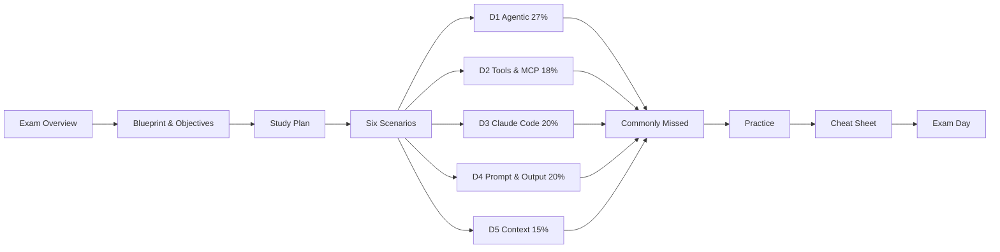

# Architect Track: CCAR-F

**Claude Certified Architect – Foundations** validates that you can make sound design trade-offs when building production systems with Claude: agents, Claude Code, prompts and structured output, tools and MCP, and context and reliability.

## Track map

## Domains at a glance

| # | Domain | Weight | Core question it asks |
|---|---|---|---|
| D1 | [Agentic Architecture & Orchestration](domains/d1-agentic-architecture.md) | **27%** | How do agents loop, delegate, hand off and always finish safely? |
| D2 | [Tool Design & MCP Integration](domains/d2-tool-design-mcp.md) | **18%** | How do you make tool selection and tool errors reliable? |
| D3 | [Claude Code Configuration & Workflows](domains/d3-claude-code.md) | **20%** | Which config mechanism, at which scope, for which guidance? |
| D4 | [Prompt Engineering & Structured Output](domains/d4-prompt-structured-output.md) | **20%** | How do you get consistent, schema-valid, non-fabricated output? |
| D5 | [Context Management & Reliability](domains/d5-context-reliability.md) | **15%** | How do you keep long work coherent, escalate correctly and review wisely? |

!!! info "Domain numbering"
    Community guides number the domains differently. This hub follows the task-statement numbering (1.x Agentic, 2.x Tools/MCP, 3.x Claude Code, 4.x Prompt/Output, 5.x Context). The weights are the same everywhere.

## Every domain page has the same structure

1. **What this domain tests**: the official-style objectives
2. **Core concepts**: explained from first principles
3. **Patterns & code**: what "good" looks like
4. **Anti-patterns & exam traps**: what the wrong options look like
5. **Decision rules**: one-liners to memorise
6. **Check yourself**: collapsible questions
