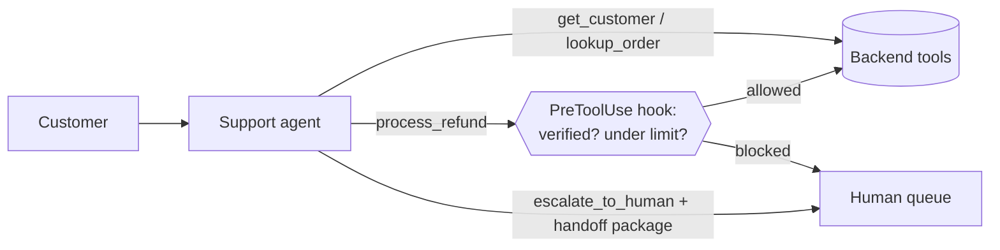
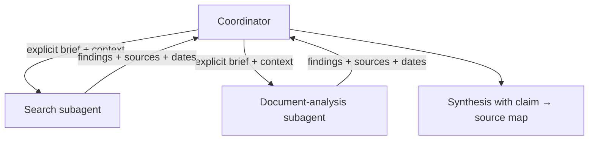

# The Six Scenarios L3

Public descriptions of the exam say questions are framed around **four scenarios drawn from a published set of six** business themes. The architectures, risks and controls below are **our own teaching material** for each theme. They are not exam content. Prepare all six.

---

## 1. Customer Support Resolution Agent

*An agent resolves customer issues (orders, refunds, account changes) using backend tools, escalating to humans when needed.*

| Risk | Control |
|---|---|
| Refund issued before identity is verified | **Programmatic prerequisite**: a hook or gate blocks `process_refund` until `verify_customer` has succeeded |
| Refund above policy limit | **PreToolUse hook** denies or routes to approval, not a prompt instruction |
| Session ends silently, unresolved | **Orchestration safeguard**: when the loop ends, check for a resolution or escalation record; if neither exists, escalate automatically |
| Customer asks for a human | **Honour immediately**. Don't "try one more thing" |
| Human gets a cold handoff | **Structured handoff package**: verified identity, facts, actions taken, what is pending |

**Domains:** D1, D2, D5.

---

## 2. Code Generation with Claude Code

*A team uses Claude Code to write and change code in a shared repository.*

| Risk | Control |
|---|---|
| Inconsistent conventions | Project `CLAUDE.md` + `.claude/rules/` with `paths:` globs for area-specific rules |
| Code that is unformatted or fails lint | **PostToolUse hook** on Edit/Write runs formatter/linter every time |
| Large risky refactor goes wrong | **Plan mode** first; review the plan; then execute |
| Context fills up on a big codebase | Subagents for exploration, scratchpad notes, `/compact`, targeted Grep → Read |

**Domains:** D3, D5.

---

## 3. Multi-Agent Research System

*A coordinator agent breaks a research question into parts, delegates to search/analysis subagents, and synthesises a cited report.*

| Risk | Control |
|---|---|
| Subagent lacks needed context | Pass context **explicitly** in the delegation; subagents don't inherit the coordinator's history |
| Decomposition too narrow, so topics are missed | Coordinator reviews coverage and generates follow-up subtasks **dynamically** |
| Coordinator's context floods | Subagents return **condensed, structured** findings, not raw dumps |
| Conflicting sources | Keep both, **annotate the conflict** with source and date; don't silently pick one |
| Unverifiable claims | **Claim → source mapping** preserved through to the final report |

**Domains:** D1, D2, D5.

---

## 4. Developer Productivity with Claude

*Engineers use Claude (Agent SDK, Claude Code, MCP) to explore unfamiliar codebases, automate chores and integrate internal tools.*

| Risk | Control |
|---|---|
| Too many tools → wrong tool chosen | Give each agent **only the tools it needs**; sharpen descriptions |
| Wasteful exploration | Grep (content) / Glob (file names) first, then targeted Read |
| Team tool available on one laptop only | MCP server at **project scope** in `.mcp.json`; secrets via `${ENV_VAR}` |
| Repeated workflow typed by hand | **Custom slash command** in `.claude/commands/` (team) or `~/.claude/commands/` (personal) |

**Domains:** D2, D3, D1.

---

## 5. Claude Code for Continuous Integration

*Claude Code runs in CI to review pull requests, generate tests or triage failures.*

| Risk | Control |
|---|---|
| CI step hangs waiting for input | Non-interactive mode: `claude -p "…"` |
| Pipeline can't parse the output | `--output-format json` (plus a schema for the result where supported) |
| Reviewer marks its own homework | **Separate, independent session/instance** reviews the generated code |
| Long review misses cross-file issues | Per-file passes **plus** a cross-file integration pass |
| Blocking merge check | **Synchronous** calls. Batch is for non-blocking bulk work |

**Domains:** D3, D4.

---

## 6. Structured Data Extraction

*Extract fields from varied documents (invoices, contracts, forms) into a downstream system.*

| Risk | Control |
|---|---|
| Free-text reply breaks the parser | Tool with JSON schema + **forced `tool_choice`** |
| Model invents missing values | **Optional / nullable** fields; enums with `"unknown"` / `"not_present"`; instruct "null if absent" |
| Inconsistent formats (dates, currency) | Normalisation rules + **few-shot examples** across varied layouts |
| Retry won't fix missing data | Retry only on **format/validation** errors, with the specific error appended |
| Aggregate accuracy hides bad fields | **Field-level** accuracy and confidence; stratified review sampling |
| Wrong items sent for review | Route by **confidence, doc type, field ambiguity**, not randomly |
| Huge non-urgent backlog | **Message Batches API** (≈50% cheaper), correlate with `custom_id` |

**Domains:** D4, D5.
