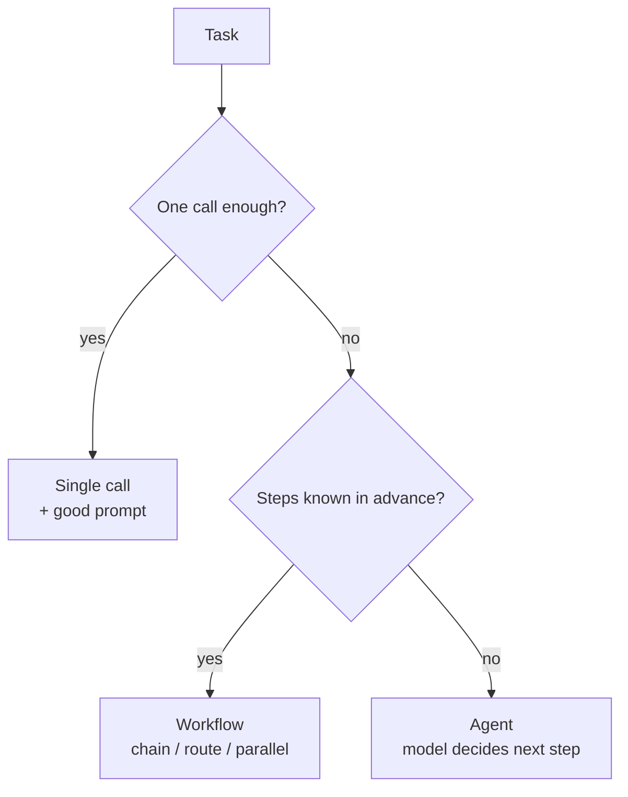
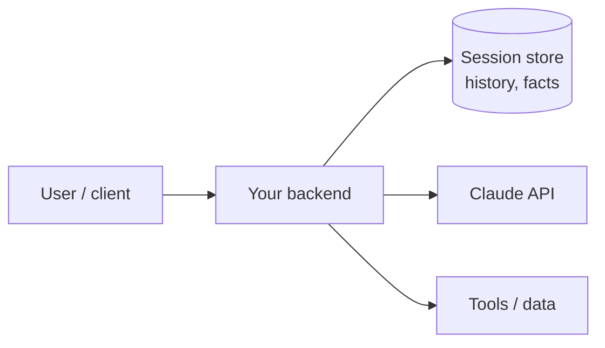
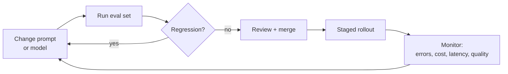

# Applications & Integration · Part 2: Application Design <span class="level-badge">33.1%</span>

The largest single skills on the exam sit here: designing a Claude application, applying ordinary software-engineering discipline to it, and managing its configuration. Most questions describe a situation and ask for the **most appropriate** design.

## What this page covers

* Turning requirements into a design
* Choosing an interaction pattern
* Session and state handling
* Schema design and validation
* Reliability: timeouts, retries, idempotency, fallbacks
* Configuration, versioning and the system life cycle

---

## 1. Requirements first

Before any code, answer five questions. Many exam scenarios are solved by noticing which one the team skipped.

| Question | It decides |
|---|---|
| Is a person waiting for the answer? | sync + streaming, or batch |
| How bad is a wrong answer? | validation, human review, model tier |
| How much volume, and how spiky? | rate-limit design, queues, caching, batch |
| What data does Claude need, and may it see it? | retrieval, tools, PII handling |
| How will we know it works? | success criteria and an eval set, **before** launch |

## 2. Pick the simplest pattern that works



Start at the top and move down **only when the simpler option fails**. More autonomy means more cost, more latency and less predictability. "Use an agent" is rarely the right answer to a task with fixed steps.

| Need | Pattern |
|---|---|
| Classify, extract, summarise one item | Single call |
| Fixed sequence of transformations | Prompt chain, with a check between steps |
| Different handling per input type | Router (often a small, fast model) |
| Independent sub-tasks | Parallel calls, then combine |
| Answers from your own documents | Retrieval (RAG): fetch relevant chunks, put them in the prompt |
| Open-ended, steps unknown | Agent with tools |

## 3. Where state lives

The API is stateless, so the application owns all state.



* **Session store**: history keyed by *your* session ID. Load, append, send, save.
* **The client never calls Claude directly.** The API key stays on the backend ([Security](d6-security-safety.md)).
* **Long sessions**: don't resend everything for ever. Summarise older turns, keep key facts in a structured block, and drop stale tool output ([Prompt & Context](d4-prompt-context.md)).
* **Concurrency**: two requests for one session can interleave. Serialise per session or use optimistic locking, as you would for any shared record.
* **Multi-user**: never mix one user's history into another's request. Scope every read by the authenticated user.

## 4. Schema design

Whenever code consumes Claude's output, define a schema.

```python
from pydantic import BaseModel, Field
from typing import Literal, Optional

class Ticket(BaseModel):
    category: Literal["billing", "technical", "account", "other"]
    urgency: Literal["low", "medium", "high"]
    order_ref: Optional[str] = Field(None, description="Format ORD-#####, null if absent")
    summary: str
```

Good schema habits (all testable):

* **Enums** for closed sets, plus an `"other"` escape value so the model is not forced into a wrong label.
* **Nullable fields** for information that may be absent. A required field with no source invites invention.
* **Field descriptions** carry format rules; the model reads them.
* **Flat beats deep.** Deep nesting raises error rates.
* A schema guarantees **shape**, never **truth**. `total: 500` can be valid JSON and still wrong. Add semantic checks in code (do line items sum to the total?).

Then validate at the boundary, exactly as you would with any external input:

```python
try:
    ticket = Ticket.model_validate_json(raw_text)
except ValidationError as err:
    ...  # retry once with the error message, or route to a human queue
```

## 5. Reliability engineering

Treat the Claude API like any other remote dependency.

| Technique | Why |
|---|---|
| **Timeouts** | A hung call must not hang your user. Set one that suits the task |
| **Bounded retries with backoff + jitter** | Recover from 429/5xx without a retry storm |
| **Idempotency** | A retried step must not charge a customer twice. Use an idempotency key in *your* side effects |
| **Circuit breaker / fallback** | After repeated failures, stop calling and degrade gracefully (cached answer, simpler path, "try again later") |
| **Queues** | Absorb bursts instead of tripping rate limits |
| **Graceful degradation** | Partial result + clear message beats a stack trace |
| **Validate outputs** | Model output is untrusted input to the rest of your system |

!!! warning "Retries and side effects"
    Retrying a *read* is harmless. Retrying a call after which your code *did something* (sent an email, issued a refund) is not. Keep side effects in your own code, behind idempotency keys, never implied by a model response alone.

## 6. Configuration management

Hard-coded values are a recurring wrong answer.

| Thing | Where it belongs |
|---|---|
| API keys | Environment variable or secret manager. Never in code, prompts or the repo |
| Model ID | Configuration, so you can change it without a code change |
| Prompts | **Version-controlled** files, reviewed like code |
| `max_tokens`, temperature, timeouts | Configuration per environment |
| Dev / staging / prod | Separate keys and settings (separate workspaces help track usage and limit blast radius) |

**Pin a specific model version** in production rather than a moving alias. Behaviour can shift between versions, so a model change should be a deliberate, tested release.

## 7. Version control and the life cycle

A prompt change is a behaviour change. Give it the same process as code:



* Prompts, tool definitions and schemas live in **git**.
* An **eval set** runs on every change ([Evals](d7-claude-code-evals.md)).
* **Roll out gradually** and keep a quick way back.
* **Monitor in production**: error rate by type, token usage and cost, latency, `stop_reason` distribution, validation failures.
* **Model deprecations happen.** Keeping the model ID in config and an eval set ready is what makes migration a small job.

## 8. Authentication, in one table

| Layer | Who proves identity to whom | How |
|---|---|---|
| Your app → Claude API | Your organisation | API key in `x-api-key`, held server-side |
| End user → your app | The user | Your normal auth (sessions, OAuth, SSO) |
| Your tools → your systems | The **user's** permissions | Enforced in tool code from the authenticated session |

The API key identifies your *organisation*. It says nothing about which of your users is asking. User-level access control is always your code's job.

---

## Traps

| Tempting answer | Why it's wrong |
|---|---|
| Build a multi-agent system for a fixed three-step task | A chain is cheaper, faster and testable |
| Call the API from the browser to cut latency | Exposes the API key |
| Put the model name and key in source for simplicity | Config and secrets belong outside code |
| Trust schema-valid output as correct | Shape is not truth; add semantic validation |
| Unlimited retries until it works | Retry storms; bound them and add backoff |
| Ship the prompt change, watch for complaints | Run the eval set first |
| Use a `latest` alias in production | Unplanned behaviour changes; pin a version |

## Decision rules

1. **Simplest pattern that meets the requirement.**
2. **State, auth and side effects live in your code.**
3. **Schema at every boundary; validate shape *and* meaning.**
4. **Bounded retries, timeouts, idempotent side effects, a fallback.**
5. **Keys in a secret store; model and prompts in versioned config.**
6. **No prompt or model change ships without the eval set.**

## Check yourself

??? question "A mobile team wants the app to call the Claude API directly 'to save a hop'. What do you recommend?"
    Route through a backend. The key must stay server-side; the backend also gives you auth, rate limiting, logging and a place for validation.

??? question "An invoice extractor returns valid JSON where line items don't add up to the total. What's missing?"
    Semantic validation in code. The schema only guarantees structure. Add a sum check and route failures to a retry or a human.

??? question "A fixed pipeline: translate → summarise → format. A teammate proposes an autonomous agent. Your view?"
    A prompt chain. The steps are known in advance, so a workflow is cheaper, faster and easier to test than an agent.

??? question "A retried request caused a duplicate refund. What design principle was missed?"
    Idempotency. Side effects need an idempotency key so a repeated attempt is recognised and not executed twice.

??? question "The team must move to a newer model next month. What makes that low-risk?"
    Model ID in configuration, a pinned version, and an eval set to compare old and new before a staged rollout.

---

!!! abstract "Verify in official docs"
    * [Building effective agents (workflows vs agents)](https://www.anthropic.com/engineering/building-effective-agents)
    * [Structured outputs](https://platform.claude.com/docs/en/build-with-claude/structured-outputs)
    * [Models overview](https://platform.claude.com/docs/en/models/overview)
