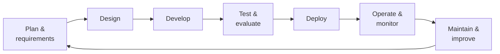

# Applications & Integration · Part 3: Engineering Foundations <span class="level-badge">33.1%</span>

The official blueprint gives real weight to plain software engineering: requirements, the system life cycle, REST and JSON, asynchronous code, version control, code review and refactoring. None of it is Claude-specific, which is exactly why it is easy to under-prepare. Together with *Technical Fundamentals* in the model-selection domain, these skills are worth roughly **one question in five**.

## What this page covers

* From business requirement to functional and infrastructure requirements
* The systems life cycle
* REST, JSON, SDKs and raw HTTP
* Synchronous, streaming, asynchronous, and WebSockets
* Version control, code review and refactoring with Claude in the loop
* Calling Claude through cloud platforms

---

## 1. Understanding requirements

A business requirement says **what outcome** is wanted. Your job is to turn it into two kinds of technical requirement.

| Kind | Question it answers | Examples |
|---|---|---|
| **Functional** | What must the system *do*? | Classify tickets into 6 categories; extract 12 fields; answer from the policy library with citations |
| **Infrastructure** (non-functional) | How well, how fast, how safely, at what cost? | Latency, throughput, availability, cost ceiling, data residency, retention, auditability, security |

**Worked example.** *"Reduce support response time."*

| Derived requirement | Type | Design consequence |
|---|---|---|
| Draft a reply for each incoming ticket | Functional | Single call or short chain |
| Draft visible within 3 seconds | Infrastructure | Streaming, small or mid tier |
| 20,000 tickets a day, peaks at 9 am | Infrastructure | Queue, rate-limit plan, caching |
| Customer data must stay in one region | Infrastructure | Platform and deployment choice |
| An agent approves before anything is sent | Functional | Human-in-the-loop step |
| 95% of drafts need no factual correction | Functional (quality bar) | Eval set and grader |

Habits the exam rewards:

* **Clarify before building.** If the requirement is ambiguous ("make it smart"), the first step is to pin down success criteria, not to choose a model.
* **Make it measurable.** "Fast" is not a requirement; "p95 under 3 seconds" is.
* **Let constraints choose the design.** Latency, volume, risk and data rules usually decide the pattern.
* **Trace each requirement to a test.** A requirement nobody verifies is a wish.

## 2. The systems life cycle



What is different when an LLM is in the system:

| Stage | LLM-specific concern |
|---|---|
| Design | Choose the pattern, the model tier and the data flow; decide what is enforced in code |
| Develop | Prompts, schemas and tool definitions are **source artefacts**, kept in version control |
| Test | Evals alongside unit tests; output is non-deterministic, so assert on properties |
| Deploy | Staged rollout; pinned model version; a way back |
| Operate | Monitor errors, latency, tokens and cost, `stop_reason`, validation failures |
| Maintain | Model deprecations and behaviour changes between releases; prompt drift; new failure cases fed back into evals |

Maintenance is not optional. **Models are retired and newer ones behave differently**, so a system that is never revisited will eventually break without any code change.

## 3. REST and JSON

The Claude API is a **REST API**: HTTPS requests with JSON bodies.

| REST idea | In the Claude API |
|---|---|
| Resource + HTTP verb | `POST /v1/messages`, `GET /v1/messages/batches/{id}` |
| Stateless | Each request carries everything needed; no server-side conversation |
| Headers | Authentication, API version, content type, beta features |
| Status codes | 2xx success, 4xx client error, 5xx server error |
| Idempotency | `GET` is safe to repeat; a repeated `POST` creates a second result, so guard *your* side effects |
| Pagination | List endpoints return pages; iterate until there are no more |

**JSON essentials that cause real bugs**

* JSON has **no comments and no trailing commas**; keys and strings use **double quotes**.
* Types are limited: string, number, boolean, `null`, array, object. Dates and money are strings or numbers by your convention; state the format.
* `null`, a missing key and an empty string are three different things. Decide which one your schema means.
* Escape user text properly. Build JSON with a serialiser, never by joining strings.
* Large integers and decimals can lose precision; send money as integer minor units or strings.

**SDK or raw REST?**

| Official SDK | Raw HTTP |
|---|---|
| Typed requests and responses | Works from any language or tool |
| Automatic retries and timeouts | You write retries, backoff, timeouts |
| Streaming helpers that assemble events | You parse server-sent events yourself |
| Beta features and pagination handled | Maximum control, minimum dependencies |

An SDK is a **wrapper over the same REST API**. Anything it does, you can do by hand; it saves you from re-implementing headers, retries and stream parsing. Prefer the SDK unless you have a reason not to.

## 4. Four ways to talk to a service

| Style | Shape | Use it when |
|---|---|---|
| **Synchronous request/response** | Send, wait, receive everything | Short answers; simple backend calls |
| **Streaming (server-sent events)** | One request; the server pushes events over a held-open HTTP response | A person is watching; long outputs. **This is how the Messages API streams** |
| **Asynchronous job** | Submit, get an ID, poll or be notified later | Bulk, non-urgent work: the Message Batches API |
| **WebSocket** | One long-lived connection, **both sides send at any time** | Truly two-way, real-time channels, for example between your own client and backend |

!!! note "SSE versus WebSockets"
    Server-sent events are **one-way** (server to client) over ordinary HTTP. WebSockets are **two-way** over a persistent connection that starts with an HTTP upgrade. Token streaming only needs one direction, which is why SSE is enough. Reach for a WebSocket when the client must also send during the exchange.

## 5. Asynchronous programming

Calling an LLM is slow I/O. Async code lets one process wait on many calls at once.

```python
import asyncio
from anthropic import AsyncAnthropic

client = AsyncAnthropic()
limit = asyncio.Semaphore(5)                 # at most 5 calls in flight

async def summarise(text: str) -> str:
    async with limit:
        r = await client.messages.create(
            model=MODEL, max_tokens=300,
            messages=[{"role": "user", "content": f"Summarise:\n<doc>{text}</doc>"}])
        return r.content[0].text

async def main(docs):
    results = await asyncio.gather(*(summarise(d) for d in docs), return_exceptions=True)
    return results
```

What to know:

* **Concurrency is not free capacity.** Unbounded `gather` over 5,000 items trips rate limits at once. Bound it with a semaphore or a worker pool.
* **Handle partial failure.** One failed call must not lose the other results (`return_exceptions=True`, then retry the failures).
* **Don't block the event loop** with synchronous calls inside async code.
* **Order is not guaranteed** unless you preserve it; carry an ID with each task.
* Choose by need: *a few parallel calls for a waiting user* → async; *thousands with no one waiting* → the Batches API, which is also cheaper.

## 6. Version control and the SDLC

Everything that shapes behaviour belongs in git: code, **prompts**, tool definitions, schemas, eval sets, `CLAUDE.md`, shared settings.

* **Small, focused commits and branches** make AI-assisted changes reviewable and reversible.
* **Never commit secrets.** `.env` in `.gitignore`, secret scanning in CI.
* **CI runs tests and evals** on every change, including prompt-only changes.
* **Pull requests are the checkpoint** where a person reviews what an agent wrote.
* Claude fits *into* this process (drafting changes, reviewing diffs, writing tests in CI); it does not replace it.

### Claude across the life cycle

Anthropic's [AI-native SDLC playbook](https://claude.com/resources/articles/the-ai-native-sdlc-playbook) describes the same six stages, with one idea running through them: **every stage ends by committing an artefact that the next stage reads.** Summarised in my own words:

| Stage | What Claude does | Artefact committed | Human decision |
|---|---|---|---|
| Plan | Helps turn an idea, ticket or alert into a short written statement of intent | The intent document | Product owner accepts or rejects |
| Design | Turns the intent into requirements and a design, applying the organisation's standards (packaged as skills) and **flagging conflicts** | The specification | Owner resolves flagged concerns |
| Build | Starts in **plan mode**, produces an implementation plan, then implements | The plan, then code and tests | Engineer approves the plan before any edit |
| Test | Checks its own work with a **feedback loop** (tests, build, screenshot) | Test output attached to the change | Reviewer judges intent and risk |
| Deploy | Reviews pull requests; runs non-interactively in CI | Review findings on the pull request | A person approves; hooks gate production |
| Maintain | Is triggered by monitoring, diagnoses, proposes a fix | An incident record that becomes new intent | Owner triages |

The full picture, with the ladder of control and the working patterns, is on the [AI-Native SDLC](../../fundamentals/ai-native-sdlc.md) fundamentals page. Points worth remembering:

* **The commit history is the audit trail**: who asked for what, what the agent produced, who approved it.
* **Name one source of truth per artefact.** If tickets live in an existing tracker, either the tracker or the repository is authoritative, and the other holds a link. Two unlinked copies drift.
* **Design review moves earlier.** Correcting a plan is editing a document; correcting finished code is rework.
* **Separation of duties still holds.** The agent that wrote a change cannot approve it; branch protection keeps a human approval in the path.
* **The agent acts up to the production gate, not past it.** Anything it writes arrives as a pull request, and production release needs a named approval enforced by a hook.
* **Autonomy is tiered by environment**: free in development, gated in production.
* **Rollback is rehearsed in advance**, so that it is a known, tested path when it is needed.
* **Detection stays deterministic.** A script decides that a metric is out of range; only then is the model invoked, with permissions that depend on severity.

### Working in parallel

| | Parallel sessions | Sub-agents |
|---|---|---|
| What | Separate Claude Code instances, each in its own **git worktree** and branch | Helpers inside one session, each with its own context and tool limits |
| Share | Nothing, except the engineer steering them | The parent's task; they report back to it |
| Use for | Independent tasks that touch different files | Recurring jobs: verifying, researching, simplifying |
| Limit | How many streams one person can review properly | Token cost |

Tasks that touch the **same files** belong in one session, one after another.

### Test-first with an agent

For a bug fix: have the failing test written **first**, confirm it fails for the expected reason, commit it, then ask for the fix **without changing the test**. A test that existed before the fix and could not be rewritten is real evidence. Protect the check itself: a hook (or review rule) should stop the agent from editing or deleting tests during a fix. "Fix the code, not the test."

## 7. Code review

AI-generated code needs the same review as anyone's, with a few extra habits.

| Do | Why |
|---|---|
| Review as if a capable stranger wrote it | Fluent, confident code can still be wrong |
| Run it: tests, linters, type checks | Verification beats reading |
| Check the edges: errors, empty input, concurrency, security | Generated code often covers only the happy path |
| Look for invented APIs, packages or flags | A known failure mode; check they exist |
| Review with a **separate** session or reviewer | The author's context shares the author's blind spots |
| Keep a human approval for risky changes | Accountability stays with people |
| Give the automated reviewer written criteria: what to check, what counts as important, what to skip, a cap on minor comments | Consistent reviews and fewer noisy findings |
| Feed repeated findings back into `CLAUDE.md` | The same mistake stops recurring |

## 8. Refactoring

| | Small-scale | Large-scale |
|---|---|---|
| Scope | A function, a file | Many files, a migration |
| Approach | Direct edit, run tests | **Plan first**, then small verifiable steps |
| Safety net | Existing tests | Tests written *before* the change; a branch; frequent commits |
| Context | Fits in one session | Split by module; use sub-agents or fresh sessions; keep a written plan and progress notes |
| Failure mode | Minor regressions | Half-finished migration, drift from the plan, context overload |

The rule for large changes: **explore → plan → implement in steps → verify each step**. Behaviour should not change during a refactor, so tests passing before and after is the evidence.

## 9. Calling Claude through a cloud platform

Claude is also offered through cloud vendors (for example Amazon Bedrock, Google Cloud's Vertex AI and Microsoft Foundry). What changes:

| Stays the same | Differs |
|---|---|
| The model family and the Messages request shape, broadly | **Authentication** uses the cloud's own credentials and IAM |
| Core concepts: tokens, tools, streaming | **Model identifiers** and versions are named differently |
| | **Feature availability** can lag or differ, especially beta features |
| | Billing, quotas, regions and data handling follow the cloud provider |

Reasons to choose a cloud platform are usually organisational: existing contracts, data-residency and compliance needs, consolidated billing, private networking. Before relying on a feature, **check that it exists on the platform you deploy to**.

**Data handling.** Know where prompts and outputs go and how long they are kept. Stateful features (stored files, sessions, batches awaiting results) keep data for a period by design, and some features are not eligible for zero-retention arrangements. For regulated data, confirm retention and eligibility for each feature you use.

---

## Traps

| Tempting answer | Why it's wrong |
|---|---|
| Start coding; requirements will emerge | Ambiguous goals are the most expensive bug |
| "Fast and accurate" as the requirement | Not measurable, so not testable |
| Fire 10,000 concurrent requests with `gather` | Rate limits; bound concurrency or batch |
| Build JSON with string concatenation | Breaks on quotes and newlines; use a serialiser |
| WebSocket for simple token streaming | SSE already does one-way streaming |
| Raw HTTP "for performance" | Loses retries and stream handling for no real gain |
| Merge agent-written code because tests pass | Review still needed: edge cases, security, invented APIs |
| Refactor 200 files in one prompt | Plan, split, verify step by step |
| Let the agent that wrote the change approve it | No separation of duties; a person approves |
| Let the agent edit a failing test to make it pass | Weakens the check; fix the code |
| Run two parallel sessions on the same files | Conflicting edits; use one session or separate files |
| Assume a beta feature exists on every cloud | Check per platform |

## Decision rules

1. **Business goal → functional + infrastructure requirements → measurable tests.**
2. **Constraints choose the design.**
3. **SDK by default; it wraps the same REST API.**
4. **Waiting user → sync/stream. Many parallel → bounded async. Bulk offline → batch. Two-way live → WebSocket.**
5. **Everything that shapes behaviour is versioned and reviewed.**
6. **Large change: plan, small steps, tests before and after.**

## Check yourself

??? question "A stakeholder asks for 'an AI that handles returns'. What is your first step?"
    Clarify and write measurable functional and infrastructure requirements (what it must do, volume, latency, risk, data rules, success criteria) before picking a design.

??? question "'Responses must stay within one geographic region.' Functional or infrastructure?"
    Infrastructure (non-functional). It constrains platform and deployment, not what the feature does.

??? question "A script summarises 3,000 files with unbounded `asyncio.gather` and gets a wall of 429s. Two fixes?"
    Bound concurrency with a semaphore or worker pool; or, if nobody is waiting, use the Message Batches API.

??? question "Why does the Messages API use server-sent events instead of WebSockets for streaming?"
    Streaming tokens only needs server-to-client flow, which SSE provides over plain HTTP. WebSockets are for two-way communication.

??? question "An agent proposes a 150-file migration. How should it be run?"
    Plan first, write or confirm tests, then proceed module by module on a branch with small commits, verifying at each step.

??? question "A feature works on the direct API but fails after moving to a cloud platform. First thing to check?"
    Whether that feature (and that model version) is available on the platform, and whether identifiers and authentication were changed accordingly.

---

!!! abstract "Verify in official docs"
    * [Messages API reference](https://platform.claude.com/docs/en/api/messages)
    * [Models overview](https://platform.claude.com/docs/en/models/overview)
    * [Claude Code documentation](https://code.claude.com/docs)
