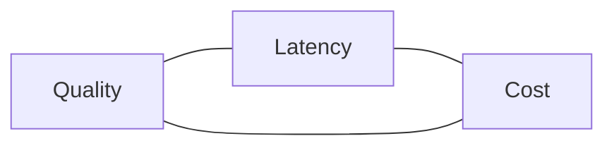

# Model Selection & Optimisation <span class="level-badge">16.8%</span>

The second-largest domain. It tests whether you understand **how LLMs behave** (tokens, context, sampling) and whether you can balance **quality, latency and cost** with the right model and the right optimisation.

## What this domain covers

* LLM fundamentals: tokens, context windows, sampling, non-determinism
* Model tiers and how to choose
* Extended thinking and effort
* Prompt caching, in depth
* Cost estimation and token budgeting
* Latency levers

---

## 1. LLM fundamentals

**Tokens.** Models read and write tokens, pieces of words. As a rough guide for English, one token is about three-quarters of a word. You are billed per token, limits are in tokens, and **output tokens cost several times more than input tokens**.

**Context window.** The total a model can consider in one request: system prompt + tools + full message history + the output being generated (thinking included).

```text
context window  ≥  input tokens (system + tools + messages)  +  output tokens
```

* A larger window is **not** a memory. Nothing persists between calls.
* Filling the window is not free: every token is billed, latency rises, and details buried in the middle of very long inputs get less attention.
* For long documents: put the **documents first and the question last**.

**Sampling.** The model produces a probability for each possible next token and samples one.

| Setting | Effect |
|---|---|
| `temperature` near 0 | Picks the most likely tokens: consistent, good for extraction and classification |
| `temperature` near 1 | More varied: good for brainstorming and creative writing |
| `top_p`, `top_k` | Advanced alternatives; adjust temperature *or* these, not both |

**Non-determinism.** Even at temperature 0, two identical requests can differ. Design for it:

* Never assert exact string equality in tests. Check structure, required facts or a grader score.
* Get consistency from **clear instructions, examples and structured outputs**, not from temperature alone.
* Some newer models restrict sampling parameters. Check the model's page before relying on them.

**Knowledge cutoff and hallucination.** A model knows nothing after its training cutoff and nothing about your private data. Supply facts through context (retrieval, tools); ask it to quote sources and to say "I don't know".

## 2. Model tiers

Claude models come in tiers. Names and versions change often, so learn the **shape** and read current IDs from the [Models overview](https://platform.claude.com/docs/en/models/overview).

| Tier | Character | Typical use |
|---|---|---|
| **Haiku** | Fastest, cheapest | Classification, routing, extraction, screening, high-volume or real-time work, sub-agents |
| **Sonnet** | Balanced | Most production work: coding, analysis, agents, customer-facing chat |
| **Opus** (and any tier above) | Most capable, slowest, most expensive | Hard reasoning, long autonomous tasks, cases where a wrong answer is costly |

Two sound ways to choose:

1. **Start small, move up.** Begin with the cheapest model; step up only if your evals show it falls short. Best for high volume and tight latency.
2. **Start capable, optimise down.** Get it working with a strong model, then test whether a cheaper one holds quality. Best for complex tasks.

Either way the decision is made by **your eval set**, not by intuition or a public benchmark.

**Mix tiers in one system.** A small model routes or screens; a larger one handles the hard cases. An orchestrator on a capable model can delegate simple sub-tasks to cheaper sub-agents.

!!! warning "Trap: biggest model everywhere"
    "Use the most capable model for everything" is wrong when the task is simple, the volume is high or latency matters. Equally, "use the cheapest model" is wrong when errors are expensive. Match the tier to the task.

## 3. Extended thinking and effort

Thinking gives Claude room to reason before answering. It raises quality on hard multi-step problems and **costs output tokens and time**.

* Thinking tokens are **billed as output tokens** and count toward the context window in that turn.
* Two styles exist. The older one sets an explicit budget: `thinking={"type": "enabled", "budget_tokens": N}` (N is at least 1,024 and below `max_tokens`). Newer models use **adaptive** thinking, `thinking={"type": "adaptive"}`, where the model decides how much to think and you steer with an **effort** setting in `output_config`.
* Lower effort → faster and cheaper; higher effort → more thorough.
* In tool loops, pass `thinking` blocks back unchanged with the rest of the assistant content.
* Don't use thinking for simple lookups or classification. You pay for nothing.

### Fast mode

Some Opus models offer a **fast mode**: the *same model* generating output considerably faster, at a **higher price**. You opt in per request (`speed: "fast"`).

* It changes speed, not quality or capability.
* It is a premium for latency: sensible for interactive work, wasteful for background jobs.
* It is not combined with the batch discount, and availability varies by model and platform. Check the docs.

So there are now three separate dials: **which model**, **how much thinking / effort**, and **how fast**.

### Zero-shot, one-shot, multi-shot

| Style | Examples in the prompt | Trade-off |
|---|---|---|
| Zero-shot | None | Cheapest; fine for simple, well-specified tasks |
| One-shot | One | Fixes format; risk of copying that single example |
| Multi-shot (few-shot) | Several, varied | Best consistency on format and edge cases; **more input tokens on every call** |

Examples are paid for on every request, so put them in the **cached** prefix. Add examples when instructions alone don't give consistent output, not by default.

### Behaviour changes between model releases

A newer model is not a drop-in replacement. Between releases, expect differences in default tone and verbosity, how literally instructions are followed, tool-calling habits, supported parameters (some newer models restrict sampling settings or prefill, and move from thinking budgets to adaptive thinking), and token counts for the same text.

Therefore: **pin the version, read the migration notes, re-run your evals, re-count tokens, then roll out in stages.**

### SDKs, REST and WebSockets

The blueprint's *Technical Fundamentals* skill covers how developers reach the model: an SDK is a wrapper over the REST API; streaming uses server-sent events; WebSockets are for two-way channels. These are explained in [Engineering Foundations](d1-engineering-foundations.md).

## 4. Prompt caching

The single most valuable optimisation to know cold.

**Idea.** Mark a stable prefix of the prompt as cacheable. The first request writes it to the cache; later requests with the *identical* prefix read it at a fraction of the price and faster.

```python
response = client.messages.create(
    model=MODEL, max_tokens=500,
    system=[
        {"type": "text", "text": LONG_POLICY_MANUAL,
         "cache_control": {"type": "ephemeral"}},     # cache everything up to here
    ],
    messages=[{"role": "user", "content": question}],  # varies per request
)
print(response.usage.cache_creation_input_tokens, response.usage.cache_read_input_tokens)
```

| Fact | Value |
|---|---|
| Cache **write** | 1.25× base input price (5-minute TTL) or 2× (1-hour TTL) |
| Cache **read** | 0.1× base input price |
| Default lifetime | 5 minutes, **refreshed on every hit** |
| Breakpoints (cache checkpoints) | Up to 4 per request. Each marks the end of a reusable prefix |
| Prefix order | `tools` → `system` → `messages` |
| Minimum size | A model-dependent minimum (about a thousand tokens or more). Shorter prefixes are silently not cached |
| Match rule | The prefix must be **exactly identical** up to the breakpoint |

**How to tell whether it works.** Read `usage`:

* `cache_creation_input_tokens` > 0 → written this call
* `cache_read_input_tokens` > 0 → cache hit
* `input_tokens` → only the part *after* the last breakpoint

Total input = `cache_read_input_tokens` + `cache_creation_input_tokens` + `input_tokens`.

**Design rule: static first, dynamic last.**

```text
[ tool definitions ]   stable   ┐
[ system prompt    ]   stable   ├─ cached prefix
[ reference docs   ]   stable   ┘  ← breakpoint
[ conversation     ]   grows       ← optional moving breakpoint
[ new user message ]   changes
```

**Why a cache misses** (a favourite question):

* Something dynamic sits *inside* the prefix: a timestamp, a user name, a request ID
* Tool definitions changed or were reordered (that invalidates everything after)
* More than the TTL passed with no request
* The prefix is under the minimum length
* Non-deterministic serialisation, such as JSON keys in a different order each time

**When caching does not pay.** Prompts that change every time, short prompts, or traffic so sparse the cache always expires: you pay the write premium and never read.

**Several checkpoints.** With more than one breakpoint you cache layers that change at different rates: tools and system prompt (rarely), reference documents (sometimes), conversation so far (every turn). A change invalidates only what comes *after* it. In a long conversation, moving the last breakpoint forward each turn lets every new request read the previous turns from cache.

**Extra benefit.** On most current models, cached reads don't count toward the input-tokens-per-minute limit, so caching also raises throughput.

## 5. Cost estimation

```text
cost = input_tokens × input_price
     + cache_writes × input_price × 1.25
     + cache_reads  × input_price × 0.10
     + output_tokens × output_price          (thinking included)
then × 0.5 if sent through the Batches API
```

**Worked example** (illustrative prices: $3 per million input, $15 per million output). A support bot sends an 8,000-token policy prompt, a 200-token question, and gets 300 tokens back, 10,000 times a day.

| Design | Input cost | Output cost | Per day |
|---|---|---|---|
| No optimisation | 82M × $3 = $246 | 3M × $15 = $45 | **≈ $291** |
| Policy prompt cached | 80M × $0.30 + 2M × $3 = $30 | $45 | **≈ $75** |
| Cached and batched (if nobody is waiting) | ≈ $15 | ≈ $22.50 | **≈ $38** |

Lessons: a large repeated prefix dominates cost, caching removes most of it, and after that **output** is the next thing to trim.

**The cost levers, in the order to try them**

1. Trim the prompt and cap the output (ask for concise answers; set a sensible `max_tokens`)
2. Cache the stable prefix
3. Batch whatever is not time-sensitive
4. Use a smaller model where evals allow
5. Manage context: summarise, clear old tool results, retrieve only what is relevant

## 6. Token budgeting

* Use `count_tokens` before sending to check fit and enforce per-request budgets.
* Leave room for the output: `input + max_tokens` must fit the window.
* Set `max_tokens` high enough to finish; then check `stop_reason` for `max_tokens`.
* In agents, set a **total** budget (tokens, turns or money) for the whole task, not only per call.
* Record `usage` from every response, tagged by feature. You cannot optimise what you don't measure.

## 7. Latency

| Lever | Helps |
|---|---|
| Smaller model tier | Time to first token and total time |
| **Streaming** | *Perceived* latency only |
| Shorter output | Total time. Output length drives latency more than input length |
| Prompt caching | Processing time for long prefixes |
| Parallel calls | Wall-clock time for independent sub-tasks |
| Less thinking / lower effort | Total time |
| Fewer tool round-trips | Each turn is a full request |

---

## The three-way trade-off



Exam questions usually fix one corner and ask you to optimise another. Read for the constraint: *"real-time"* → latency; *"millions of documents overnight"* → cost, so batch; *"regulatory decision"* → quality, so a capable model and review.

## Traps

| Trap | Reality |
|---|---|
| "Temperature 0 guarantees identical output" | Reduces variance; not a guarantee |
| "A bigger context window means it remembers users" | No persistence; you resend |
| "Caching works on any prompt" | Needs an identical prefix above a minimum size |
| "Put the user's name at the top of the system prompt" | Breaks the cached prefix for every user |
| "Streaming halves the cost" | No cost effect |
| "Batch for the live chat to save 50%" | Batch is asynchronous; users can't wait hours |
| "Thinking always improves answers" | Wasted on simple tasks; costs output tokens |
| "Pick the model by leaderboard" | Pick by your own evals |

## Check yourself

??? question "Caching is on but `cache_read_input_tokens` is always 0. The system prompt starts with 'Current time: …'. Why?"
    The timestamp changes every request, so the prefix never matches. Move dynamic content after the cached block.

??? question "A classifier labels 2 million short messages a day into 6 categories. Which tier do you try first?"
    The smallest, fastest tier, with an eval set to confirm accuracy. Step up only if it falls short.

??? question "Users complain the answer takes 12 seconds to appear. Total time can't change. Cheapest fix?"
    Stream the response so text appears immediately.

??? question "Which costs more: 1,000 input tokens or 1,000 output tokens?"
    Output, by several times. Trimming output is often the quickest saving after caching.

??? question "A test asserts the model's reply equals a stored string and fails intermittently. Better test?"
    Assert on structure and required facts, or score with a grader. LLM output is non-deterministic.

---

!!! abstract "Verify in official docs"
    Prices, minimum cache sizes and model IDs change. Always read the current page:

    * [Models overview](https://platform.claude.com/docs/en/models/overview) · [Choosing a model](https://platform.claude.com/docs/en/about-claude/models/choosing-a-model)
    * [Context windows](https://platform.claude.com/docs/en/build-with-claude/context-windows)
    * [Token counting](https://platform.claude.com/docs/en/build-with-claude/token-counting)
