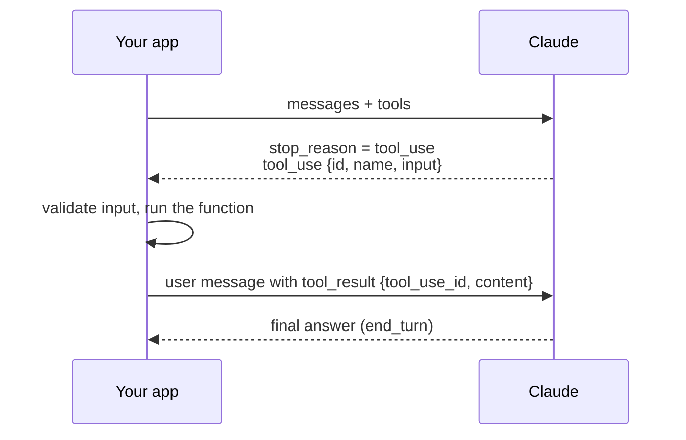
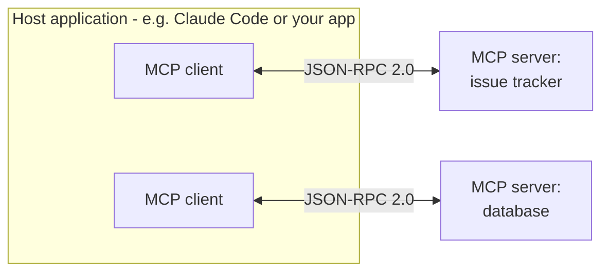

# Tools & MCPs <span class="level-badge">10.6%</span>

[Architect D2](../../architect/domains/d2-tool-design-mcp.md) covers tool *design*. The Developer exam also expects you to **implement** tools and **build an MCP server**, and to know when a server is the right choice at all.

## What this domain covers

* Implementing a tool end to end
* Tool schemas, `tool_choice`, `strict`, parallel calls
* Client tools versus server tools
* MCP architecture and primitives
* Building and testing an MCP server
* MCP server versus an application-side API client

---

## 1. Implementing a tool

A tool definition has three parts:

```python
TOOLS = [{
    "name": "get_order_status",
    "description": (
        "Look up the shipping status of ONE order by its reference. "
        "Use for 'where is my order' questions. Not for refunds. "
        "Returns status, carrier and expected delivery date."
    ),
    "input_schema": {
        "type": "object",
        "properties": {
            "order_ref": {"type": "string", "description": "Order reference, format ORD-#####"},
        },
        "required": ["order_ref"],
    },
}]
```

The round trip:



Implementation rules:

* **Claude never runs your tool.** It asks; your code executes and returns the result.
* **Validate the input** like any untrusted request (types, ranges, permissions) before executing.
* The `tool_result` goes in the **next `user` message**, with the matching **`tool_use_id`**. If there are several `tool_use` blocks, return **all** results in that one message, and put the `tool_result` blocks **before** any text.
* On failure return `is_error: true` with a useful message (what went wrong, whether a retry can help).
* **Return only what is needed.** Dumping a 5,000-line API response wastes context and hides the signal.
* Tool definitions cost input tokens on every request. Keep the set small and cache it.

## 2. Controlling tool use

| `tool_choice` | Behaviour |
|---|---|
| `{"type": "auto"}` | Claude decides (default when tools are present) |
| `{"type": "any"}` | Must call *some* tool |
| `{"type": "tool", "name": "..."}` | Must call *this* tool |
| `{"type": "none"}` | May not call tools |

* Forcing a tool (`any` / `tool`) is not compatible with manually enabled extended thinking; use `auto` there and enforce in code.
* Claude can request **several tools in one turn** (parallel tool use). Disable with `disable_parallel_tool_use: true` inside `tool_choice` when calls must be one at a time.
* **`strict: true`** on a tool makes its input conform to the schema exactly: no missing required fields, no wrong types.

## 3. Client tools and server tools

| | Client tools | Server tools |
|---|---|---|
| Who executes | **Your application** | **Anthropic's platform** |
| Examples | Your own functions, MCP tools you bridge | Web search, web fetch, code execution |
| You see | `tool_use` → you return `tool_result` | `server_tool_use` and its result already in the response |
| Special case | — | `stop_reason: pause_turn` when a long server-side loop pauses; send the content back to continue |

## 4. MCP in one picture

The **Model Context Protocol** is an open standard for connecting AI applications to tools and data, so an integration is written once and reused by any MCP-capable application.



* **Host**: the application the user works in. **Client**: one connection inside the host. **Server**: exposes capabilities. One client per server.
* Messages are **JSON-RPC 2.0**. A connection starts with an **initialise** handshake in which both sides declare capabilities.

**Three server primitives**

| Primitive | Controlled by | What it is | Example |
|---|---|---|---|
| **Tools** | The **model** | Actions the model may call | `create_issue` |
| **Resources** | The **application** | Read-only data addressed by URI | `docs://handbook/leave-policy` |
| **Prompts** | The **user** | Reusable prompt templates | a `/review-pr` template |

**Two transports**

| Transport | Use | Notes |
|---|---|---|
| **stdio** | Local server started as a child process | Simple; one user; credentials from the local environment |
| **Streamable HTTP** | Remote, shared server | Many clients; needs real authentication (OAuth / tokens). Replaces the older HTTP+SSE transport |

## 5. Build an MCP server

With the official Python SDK, a server is a few decorated functions.

```python
# server.py   (pip install "mcp[cli]")
from mcp.server.fastmcp import FastMCP

mcp = FastMCP("bookshop")

@mcp.tool()
def find_book(title: str) -> str:
    """Search the fictional bookshop catalogue by title. Returns stock and price."""
    return lookup(title)            # type hints + docstring become the tool schema

@mcp.resource("catalogue://genres")
def genres() -> str:
    """List of genres the shop stocks."""
    return "fiction, history, science, poetry"

@mcp.prompt()
def recommend(genre: str) -> str:
    """Template for a recommendation request."""
    return f"Recommend three {genre} books from the catalogue, with one line on each."

if __name__ == "__main__":
    mcp.run()                       # stdio by default
```

What to know about this code:

* **Type hints and the docstring generate the schema and description.** The docstring is the tool description the model reads, so write it as carefully as any tool description.
* `mcp.run()` uses **stdio** unless you choose another transport.
* **On stdio, never write logs to stdout.** stdout carries the protocol; a stray `print()` corrupts it. Log to **stderr**.
* Report failures as tool errors with a clear message, so the model can react.
* Read secrets from **environment variables**, not from the code.

**Test it** with the MCP Inspector (`npx @modelcontextprotocol/inspector python server.py`) before connecting a model: list the tools, call them by hand, and check the errors.

**Connect it to Claude Code**

```bash
claude mcp add bookshop -- python server.py              # local scope by default
claude mcp add --scope project bookshop -- python server.py   # shared via .mcp.json
```

```json
{
  "mcpServers": {
    "bookshop": {
      "command": "python",
      "args": ["server.py"],
      "env": {"BOOKSHOP_API_KEY": "${BOOKSHOP_API_KEY}"}
    }
  }
}
```

Scopes: **local** (you, this project) → **project** (`.mcp.json`, committed, shared with the team) → **user** (you, all projects). Secrets stay out of the file through `${VAR}` expansion.

**Debugging order when "Claude can't see my tool":** is the server running and connected (`/mcp` in Claude Code, or the Inspector)? → is it configured at the right scope? → are credentials present? → *then* look at descriptions and prompts.

## 6. MCP server or application-side API client?

A question type specific to this exam: should the integration be an MCP server, or just code in your app that calls the service?

| Choose an **application-side client** (plain tool + your own API call) | Choose an **MCP server** |
|---|---|
| One application uses the integration | **Several** applications or agents need the same integration |
| You want the fewest moving parts | You want one implementation reused across Claude Code, desktop apps and your own agents |
| Logic is tightly coupled to this app | The service owner can publish and maintain it centrally |
| Simple, internal, single-team | Standard discovery of tools, resources and prompts is useful |

Rule of thumb: **reuse across hosts → MCP server. Single app, simple call → a normal tool backed by your own client code.** MCP adds a process and a protocol; don't pay for them without the reuse.

**The MCP connector.** The Messages API can also connect straight to a **remote** MCP server (HTTP only, not local stdio) through an `mcp_servers` parameter, so you need no MCP client of your own. It is a beta feature limited to tool calls; check the docs for the current header.

## 7. MCP security

* An MCP server runs with **whatever access you give it**. Apply least privilege: read-only credentials unless writes are required, narrow scopes.
* Tool results from a server are **untrusted content**. They can carry injected instructions ([Security](d6-security-safety.md)).
* Only install servers you trust; a server's tool descriptions are read by the model.
* Remote servers need proper authentication and per-user authorisation. Don't share one powerful token across all users.

---

## Traps

| Tempting answer | Why it's wrong |
|---|---|
| "Claude calls the function directly" | Your code executes it |
| Put the tool result in an `assistant` message | It goes in the next `user` message |
| Return results for only the first of three tool calls | Every `tool_use` needs its `tool_result` |
| `print()` debugging in a stdio server | Corrupts the protocol stream; use stderr |
| Build an MCP server for one endpoint used by one app | Unneeded complexity; use a plain tool |
| Hard-code the token in `.mcp.json` | Use `${VAR}` expansion |
| Expose a read-only catalogue as 12 tools | A resource fits better |

## Check yourself

??? question "A stdio MCP server works in tests but the client reports 'invalid JSON' in use. First suspect?"
    Something is writing to stdout (a print or a library log). Send logs to stderr.

??? question "Three internal agents and Claude Code all need the same ticketing integration. Design?"
    One MCP server, maintained centrally and configured in each host.

??? question "In FastMCP, where does the tool description come from?"
    The function's docstring; the input schema comes from its type hints.

??? question "Which primitive suits a reusable 'summarise this incident' template that users pick from a menu?"
    A prompt (user-controlled).

??? question "An extraction tool must always receive every required field with the right type. Which setting?"
    `strict: true` on the tool definition.

---

!!! abstract "Verify in official docs"
    * [Tool use: implementation](https://platform.claude.com/docs/en/agents-and-tools/tool-use/implement-tool-use)
    * [MCP connector](https://platform.claude.com/docs/en/agents-and-tools/mcp-connector)
    * [Model Context Protocol](https://modelcontextprotocol.io) · [Python SDK](https://py.sdk.modelcontextprotocol.io/)
