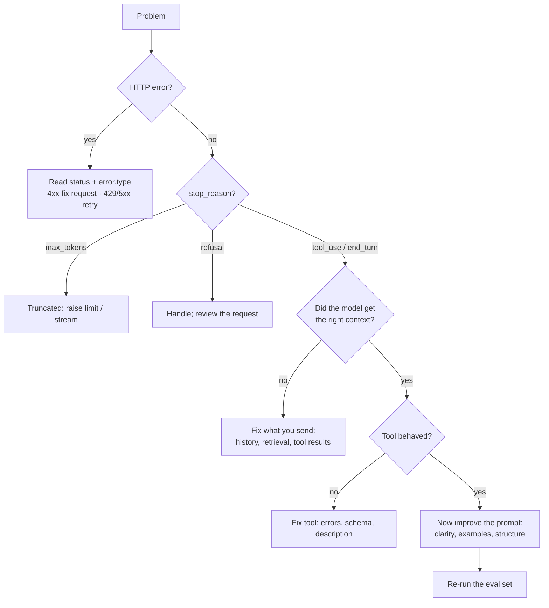

# Claude Code · Eval, Testing & Debugging 3.1% + 2.6%

Two small domains, roughly three questions together. Don't over-invest: learn the tables on this page. If you want depth on Claude Code, [Architect D3](../../architect/domains/d3-claude-code.md) has it.

---

## Part A · Claude Code (3.1%)

### What goes where

| Mechanism | What it is | Loaded |
|---|---|---|
| **`CLAUDE.md`** | Project memory: conventions, commands, architecture notes | Every session, automatically |
| **Rules** (`.claude/rules/*.md`) | Focused instructions, optionally scoped to file paths | When relevant files are touched |
| **Skills** (`.claude/skills/<name>/SKILL.md`) | Packaged know-how with optional scripts; loaded on demand | When the task matches the description |
| **Commands** (`.claude/commands/*.md`) | Reusable prompts you invoke as `/name` | When you type them |
| **Sub-agents** (`.claude/agents/*.md`) | Specialists with their own context and tools | When delegated to |
| **Hooks** (settings) | Your code at lifecycle points; can block | Deterministically, every time |
| **MCP servers** (`.mcp.json`) | External tools and data | At start-up |
| **Settings** (`.claude/settings.json`) | Permissions, hooks, environment | At start-up |

**Hierarchy.** User-level (`~/.claude/`) applies to all your projects; project-level (in the repo, committed) is shared with the team; local files (`*.local.*`, git-ignored) are personal overrides. Team standards go in **project** files.

### Getting started in a repository

`/init` analyses the codebase and writes a starter `CLAUDE.md`. Review and trim it: a short, accurate file beats a long one. `/memory` opens the memory files for editing.

### Agent memory

Besides the `CLAUDE.md` files *you* write, Claude Code can keep **its own notes** across sessions (auto memory), and a sub-agent can be given persistent memory of its own. Treat it like any memory: useful for continuity, worth reviewing, and never the place for a rule that must be enforced.

### Permissions

`allow` (no prompt) · `ask` (confirm each time) · `deny` (never). **Deny takes precedence.**

**Permission modes** set the baseline for a session:

| Mode | Behaviour |
|---|---|
| Default | Asks before edits and commands |
| Accept edits | File edits proceed; commands still ask |
| Plan | Read and plan only; no changes |
| Auto | A classifier approves routine, low-risk actions and stops risky ones |
| Bypass | Skips prompts. Only for isolated, disposable environments |

Choose the **least permissive mode that lets the task proceed**. For anything that must never happen, use `deny` or a `PreToolUse` hook, not a sentence in `CLAUDE.md`.

### Parallel work

Run independent tasks as separate sessions, each in its own **git worktree**, so they cannot collide on files. Use **sub-agents** inside a session for scoped, recurring jobs such as verifying a change in a fresh context. Shared settings in the repository apply to every session.

### Sessions

| Action | How |
|---|---|
| Continue the latest session | `claude --continue` |
| Resume a chosen session | `claude --resume` |
| Shrink a long context, keep going | `/compact` |
| Start clean | `/clear` |
| Run without interaction (headless: scripts, CI) | `claude -p "prompt"`, optionally `--output-format json` |
| Stream events from a headless run | `--output-format stream-json` |
| Built-in slash commands | `/init`, `/memory`, `/compact`, `/clear`, `/mcp`, `/agents`, `/permissions`, `/plugin` |
| Custom slash commands | A Markdown file in `.claude/commands/` (project) or `~/.claude/commands/` (personal) |
| Plan before editing | Plan mode |

**One-line choosers**

* Always-on project facts → `CLAUDE.md`
* Only for certain files → a path-scoped rule
* A repeatable procedure with resources → a skill
* A prompt you type often → a command
* Must be enforced → a hook or a permission rule

---

## Part B · Eval, Testing & Debugging (2.6%)

### Evals in five steps

1. **Define success** in measurable terms *before* building ("95% of invoices: all required fields correct").
2. **Build a test set** from realistic inputs: normal cases, edge cases, adversarial cases. Use synthetic or anonymised data.
3. **Choose a grader.**

    | Grader | Use when | Trade-off |
    |---|---|---|
    | **Code-based** (exact match, schema check, regex, numeric tolerance) | The answer is checkable by rule | Fast, cheap, objective; rigid |
    | **LLM-based** (a model scores against a rubric) | Quality is nuanced: tone, relevance, faithfulness | Scales; needs a clear rubric and spot checks |
    | **Human** | Subtle judgement; calibrating the other graders | Best quality; slow and costly |

4. **Run on every change**: prompt, model, tool definition, schema. This is **regression testing**. Test at several levels: unit (a parser, a tool), functional (one prompt against its cases), integration (the loop with real tools), end to end (the whole task).
5. **Feed production failures back** into the test set. Every incident should leave a permanent eval behind.

**Evals for the agent's configuration.** `CLAUDE.md`, skills and hooks steer the agent, so a change to them deserves the same regression testing as code. A practical pattern: collect a few dozen real tasks with accepted outcomes, run them non-interactively in CI on a schedule and whenever that configuration changes, and block the change if the pass rate drops. Treat the suite as living: retire cases that every model now passes and add new ones from monitoring.

**Feedback loop versus verifier.** A feedback loop (run the tests, the build, a screenshot comparison) runs many times *during* the task so the agent corrects itself. A verifier is a final check in a **fresh context**, so its verdict is not coloured by the assumptions that produced the work. Use both.

Calibrate an LLM grader against a set of **human-labelled** cases before trusting it, and re-check when you change the grader's prompt or model.

Guidance worth remembering: prefer **many automated cases** over a few hand-graded ones; give an LLM grader a specific rubric and ask it to reason before scoring; use a different prompt (ideally a different instance) from the one that produced the output.

!!! warning "Because output is non-deterministic"
    Don't assert exact strings. Assert structure, required facts, or a grader score above a threshold, and run important cases more than once.

### Tracing

To debug an LLM application you need to see what happened. Log for each request:

* the **request ID**, model and parameters
* the full prompt as sent (redacted), and the response
* every tool call, its input, result and duration
* `stop_reason` and `usage` (tokens, cache reads)
* latency, retries and errors

For agents, link the calls of one task under a single trace ID so you can replay the sequence.

### A debugging order

When something goes wrong, check in this order. It is cheapest first, and it stops you "fixing the prompt" for a problem that is not in the prompt.

### Integration layer or model output?

The most useful debugging question: **is the fault in what my code sent and did, or in what the model produced?**

| Evidence | Points to |
|---|---|
| HTTP error, timeout, malformed request | Integration |
| `stop_reason` of `max_tokens`; missing history; wrong or empty tool result in the trace | Integration |
| The right context was sent, the tools worked, and the answer is still wrong | Model output: improve the prompt, examples, model or thinking |
| Fails identically every time | Usually integration (deterministic) |
| Varies run to run with identical input | Usually model behaviour (non-deterministic) |

Check the trace **before** editing the prompt. A large share of "the model got it wrong" turns out to be "we sent it the wrong thing".

### Error handling and recovery

| Failure | Handle by |
|---|---|
| Transient API error (429, 5xx, network) | Bounded retry with backoff; then fallback |
| Invalid request (4xx) | Fix the code; don't retry |
| Truncated output | Check `stop_reason`; raise `max_tokens` or continue |
| Malformed model output | Validate; retry with the error message; cap; fall back to a person |
| **Malformed tool response** (tool returns junk, partial data, wrong shape) | Validate tool output in your code **before** sending it to the model; return a structured `is_error` result instead of passing garbage on |
| Tool failure | Return `is_error` with category and whether a retry can help |
| Agent stuck | Turn/budget cap, repeated-call detection, escalate with a summary |

The principle behind all of them: **fail loudly and specifically**. An empty string or a silent default hides the fault and sends the model, and you, in the wrong direction.

---

## Check yourself

??? question "A formatting rule should apply only to files under `tests/`. Which mechanism?"
    A path-scoped rule in `.claude/rules/`.

??? question "You changed one sentence of the system prompt. What happens before release?"
    The eval set runs, to catch regressions.

??? question "Quality is 'is the reply empathetic and accurate?'. Which grader?"
    An LLM-based grader with a clear rubric, calibrated against some human-graded samples.

??? question "A tool sometimes returns an HTML error page instead of JSON, and the agent then gives nonsense. Fix?"
    Validate the tool's response in code and return a structured error result (`is_error: true`) when it is malformed.

??? question "How do you run Claude Code in a CI job?"
    Non-interactive mode: `claude -p "..."`, with `--output-format json` if a script consumes the result.

---

!!! abstract "Verify in official docs"
    * Claude Code on this site: [Fundamentals → Claude Code Basics](../../fundamentals/claude-code-basics.md)
    * Evaluation on this site: [Fundamentals → Evaluation Basics](../../fundamentals/evaluation-basics.md)
    * [Claude Code documentation](https://code.claude.com/docs) · [CLI reference](https://code.claude.com/docs/en/cli)
