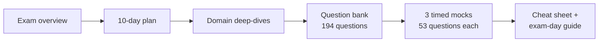

# Developer Track: CCDV-F

**Claude Certified Developer – Foundations** is the hands-on builder credential: implementing applications with the Claude API, agents, tools and MCP, Claude Code, and the security, cost and model-selection decisions that come with production.

!!! tip "Short on time?"
    Follow the **[10-Day Study Plan](study-plan-10-day.md)**. It tells you exactly what to read, build and practise each day, in order of exam weight.

## Your route through this track

| Step | Page | What you get |
|---|---|---|
| 1 | [Exam Overview](exam-overview.md) | Format, domains and weights, question types, scoring |
| 2 | [10-Day Study Plan](study-plan-10-day.md) | A day-by-day schedule with reading, a small build and practice |
| 3 | Domain deep-dives (below) | Concepts, code, traps, decision rules, self-checks |
| 4 | [Question Bank](practice-questions.md) | 194 original questions with full explanations |
| 5 | [Mock Exams](mock-exams.md) | Three timed 53-question exams, including multiple-response items |
| 6 | [Cheat Sheet](cheat-sheet.md) · [Exam Day Guide](exam-day.md) | Last-day revision and a strategy for the sitting |

## Domains, by weight

| Weight | Domain | Deep-dive |
|---|---|---|
| **33.1%** | Applications & Integration | [Part 1 · API Mechanics](domains/d1-api-mechanics.md) · [Part 2 · Application Design](domains/d1-application-design.md) · [Part 3 · Engineering Foundations](domains/d1-engineering-foundations.md) |
| **16.8%** | Model Selection & Optimisation | [Models, tokens, caching, cost](domains/d2-model-selection.md) |
| **14.7%** | Agents & Workflows | [Loops, stop conditions, Agent SDK](domains/d3-agents-workflows.md) |
| **11.0%** | Prompt & Context Engineering | [Structured output, validation, context](domains/d4-prompt-context.md) |
| **10.6%** | Tools & MCPs | [Tool implementation, building an MCP server](domains/d5-tools-mcp.md) |
| **8.1%** | Security & Safety | [Injection, guardrails, secrets, access](domains/d6-security-safety.md) |
| **3.1% + 2.6%** | Claude Code · Eval, Testing & Debugging | [Two small domains on one page](domains/d7-claude-code-evals.md) |

The first two rows are **half the exam**. Spend your time accordingly.

## Coming from the Architect track?

About 40% of this exam (agents, prompting, tools, Claude Code) overlaps with CCAR-F. The [Architect → Developer Bridge](bridge-from-architect.md) shows what you can skim and what is new.

!!! note "Unofficial study material"
    This track is written from public documentation and general engineering practice, and mapped to the skill list in the official exam guide. It is not affiliated with or endorsed by Anthropic, and it contains no real exam questions. The [official exam guide and prep courses](exam-overview.md#official-resources) are the authority on what is tested.
