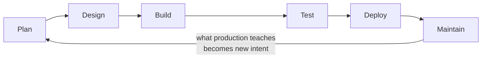

# The AI-Native SDLC L2

When an agent can write code in minutes, writing code stops being the slow part of delivering software. The slow parts become everything around it: deciding what to build, reviewing it, and releasing it safely. This page explains how teams reorganise the software development life cycle (SDLC) around that fact, while keeping people accountable for the decisions.

!!! abstract "Source and scope"
    This page is a study summary, in my own words, of ideas from Anthropic's **[AI-native SDLC playbook](https://claude.com/resources/articles/the-ai-native-sdlc-playbook)**. The playbook has worked examples, configuration samples and measurement advice that are not repeated here. Read the original for the detail; use this page to revise the concepts.

    **Why it matters for the exams:** it ties together plan mode, `CLAUDE.md`, skills, hooks, sub-agents, evals and CI, which appear across the Architect (D3) and Developer (Applications & Integration, Security, Claude Code, Evals) blueprints.

## 1. The core idea

In a traditional process each stage is owned by a different role, and work moves between them through documents, tickets and sign-offs. Those controls were sized for a world where people wrote every line.

Once the build stage speeds up, three things follow:

* **The bottleneck moves** to the human-speed steps on either side of building: planning, review and testing, release.
* **Line-by-line manual control stops scaling.** Reading every line made sense when a person wrote it; it cannot keep pace with agent output.
* **Slow governance gets expensive.** Exceptions that wait for a weekly meeting now hold up work that took an hour to produce.

The answer is not to remove control. It is to **move human attention to where judgement is needed, and to enforce the rest in configuration and code.**

The life cycle becomes a **loop**: what is learned in production feeds straight back into planning.

## 2. Every stage hands over a written artefact

The thread that holds the loop together: **each stage ends by committing something to version control, and the next stage starts by reading it.**

| Stage | The artefact | Who decides |
|---|---|---|
| Plan | A short statement of **intent**: the problem, the wanted outcome, who is affected, constraints, open questions | Product owner accepts or rejects |
| Design | A **specification** combining requirements and design, with conflicts flagged | Product owner, with policy owners for flagged items |
| Build | An implementation **plan**, then the code and its tests | Engineer approves the plan before any edit |
| Test | The **evidence**: test, build and lint output attached to the change | Reviewer |
| Deploy | The **pull request** with review findings and approvals | Code owner; release approver for production |
| Maintain | An **incident record**, which becomes new intent | Service owner triages |

Why this design works:

* Early artefacts are plain Markdown, so a product owner and an agent can both read and act on the same file.
* **The commit history is the audit trail**: who asked, what was produced, who approved.
* Where an existing system (a ticket tracker, a requirements tool) already holds a record, **name one source of truth** and link the other to it. Two unlinked copies drift apart.

## 3. Stage by stage

**Plan.** The person with the idea describes it to Claude in their own words. Claude asks the questions an analyst would, and writes the result in the team's template. The originator corrects it; the product owner decides. Nothing is lost in a chain of hand-offs.

**Design.** Requirements and design happen in one session. The organisation's standards (security, brand, compliance, UX) are available as **skills**, so policy is applied *while* the specification is written, not discovered in a review weeks later. Claude is asked to **flag** anything it could not satisfy, and those flags are resolved before engineering starts.

**Build.** Work starts in **plan mode**: Claude reads the codebase without changing it and proposes which files change, in what order, and what will prove it works. The engineer questions the plan (what could break? which step is riskiest? what was rejected?) until someone who never saw the conversation could implement from it. Only then does implementation start. As guardrails mature, routine work can run with fewer prompts (**auto mode**), and attention shifts from watching edits to reviewing results.

**Test.** Give the agent a way to check its own work: a single command for tests, one for the build, a screenshot comparison for interfaces. State a target it can verify without asking you.

**Deploy.** Claude reviews every pull request against written criteria and can address review comments on its own changes. Approval stays with a person. Claude also runs non-interactively in the pipeline for judgement steps such as triaging a failed build.

**Maintain.** A deterministic monitor notices that a metric has left its normal range and invokes Claude. What Claude may do depends on severity: only log, diagnose read-only, or propose a fix through the normal review gate. Its findings re-enter the loop as new intent.

## 4. Where knowledge lives

| Mechanism | Holds | Guidance |
|---|---|---|
| **`CLAUDE.md`** | What a new team member needs on day one: commands, conventions, architecture, recurring mistakes | Generate a first draft, then cut it down. Keep it short: it is read every session. When the same mistake happens twice, add the correction |
| **Skills** | Institutional knowledge that must be applied consistently: a security standard, an API convention | One policy per skill, with a named owner. The description decides when it triggers, so test that it does. Update centrally when policy changes |
| **Sub-agents** | Repeatable jobs: a verifier, a researcher, a simplifier | Defined in the repository with a description and limited tools |
| **Plugins** | A bundle of the above | For distributing across an organisation |

Rule of thumb: project facts go in `CLAUDE.md`; a policy that many teams must follow becomes a skill.

## 5. The ladder of control

The most examinable idea on this page. Controls differ in strength, and each has a job.

| Strength | Mechanism | What it does | Can it be bypassed? |
|---|---|---|---|
| Advisory | `CLAUDE.md`, skills | Makes the right behaviour likely | Yes. Nothing forces compliance |
| Deterministic | **Hooks**, permission rules | Runs on every matching action: allow, ask or block | Only by changing committed settings, which is visible in review |
| Organisation-enforced | **Managed settings** | Admin-deployed rules that project and personal settings cannot override | Not by individual engineers |
| Environment-level | **Sandbox** | Limits what any command can reach: network allow-list, blocked credential files | Not from inside the session |

> A skill makes a violation rare. A hook makes it close to impossible. Managed settings stop the hook being removed. A sandbox covers what tool permissions cannot see.

Two placement rules for hooks:

* **During the build:** hooks that only allow or block, kept fast and scoped to the changed file. For example, protecting generated files, running the formatter, keeping credentials out of a change.
* **At release:** hooks that **ask a named person**. Putting an approval prompt on every edit puts a human back on the critical path of every session.

A block should explain itself: the reason, and how to get approval.

## 6. Working patterns

**Parallel sessions and sub-agents**

| | Parallel sessions | Sub-agents |
|---|---|---|
| What | Separate Claude Code instances, each in its own git **worktree** | Scoped helpers inside one session |
| Good for | Independent tasks touching different files | Recurring jobs with their own context and tool limits |
| Limit | How many streams one person can review properly | Token cost |

Tasks that share files stay in one session, in sequence.

**Feedback loop versus verifier.** The feedback loop runs many times *during* the task so the agent corrects itself. A verifier is a final check in a **fresh context**, so it is not influenced by the assumptions that produced the work.

**Test-first fixes.** Write the failing test, confirm it fails for the right reason, commit it, then fix the code **without editing the test**. Protect the test with a hook or a review rule: an agent fixing code must not be able to weaken the check on that code.

**Evals for configuration.** `CLAUDE.md`, skills and hooks steer the agent, so changing them is a behaviour change. Keep a suite of real tasks with accepted outcomes, run it in CI on a schedule and whenever that configuration changes, and add a case for every production incident.

**Review with written criteria.** Tell the reviewing agent what to check (bugs, security, conformance to the specification and plan), what counts as important, what to skip, and how many minor comments to report. Findings inform the human approver; they do not replace the approval.

## 7. Governance in five sentences

1. **People stay accountable** for every decision that needs judgement; their attention moves to the gates.
2. **Separation of duties holds:** the agent that wrote a change cannot approve it.
3. **The agent acts up to the production gate and not past it:** everything it writes arrives as a pull request, and a production release needs a named approval.
4. **Autonomy is tiered by environment:** free in development, gated in production, with rollback rehearsed in advance.
5. **Detection is deterministic:** a script decides something is wrong; the model is invoked only afterwards, with permissions set by severity.

## 8. Measuring whether it works

Each change to the process should have an early signal and a later one.

| Early signal | Later signal |
|---|---|
| Time from idea to a committed statement of intent | Share of intents accepted into design |
| Share of changes that merge on the first implementation pass | Rework after build starts |
| First-pass CI success for agent-written changes | Review time per change; change failure rate |
| Time to first review | Defects caught before merge versus in production |
| Eval pass rate over time | Regressions caught in CI versus in production |

Most of these can be read from data the team already has: git history, pull-request metadata, CI results and the incident tracker.

## Traps

| Tempting idea | Why it's wrong |
|---|---|
| "AI writes the code, so remove the reviews" | Controls move and change form; they don't disappear |
| "Put the policy in a skill and it's enforced" | A skill is advisory; back it with a hook |
| "Ask for human approval on every action to be safe" | Approval fatigue, and it stalls parallel work |
| "Let the agent approve its own pull request" | No separation of duties |
| "Let the model decide when production is unhealthy" | Detection should be deterministic |
| "Start coding straight from the idea" | Plan first; fixing a plan is cheap, fixing code is not |
| "Deny the fetch tool and the network is blocked" | Shell commands can still reach it; use a sandbox |

## Check yourself

??? question "Once agents write most of the code, where does the bottleneck move?"
    To the human-speed steps around building: planning, review and testing, and release.

??? question "What turns the life cycle into an auditable chain?"
    Each stage commits a written artefact (intent, specification, plan, code and tests, review findings, incident record) that the next stage reads. The commit history is the audit trail.

??? question "A security rule must hold in every session and no engineer may disable it. Which mechanism?"
    Managed settings deployed by administrators, with a hook enforcing the rule. A skill or `CLAUDE.md` entry alone is advisory.

??? question "Why start a change in plan mode?"
    The design is reviewed before any code exists, when changing course means editing a document. Claude cannot edit files until the plan is accepted.

??? question "How is a verifier different from a feedback loop?"
    The loop runs repeatedly during the task for self-correction. The verifier is one independent check at the end, in a fresh context.

??? question "An agent may deploy freely to development. What should differ in production?"
    The agent prepares the release, and a named person authorises it, enforced by a hook. Rollback is rehearsed in advance.

---

**Go deeper on this site:** [Claude Code Basics](claude-code-basics.md) · [Evaluation Basics](evaluation-basics.md) · [Architect D3 · Claude Code](../architect/domains/d3-claude-code.md) · [Developer · Engineering Foundations](../developer/domains/d1-engineering-foundations.md) · [Developer · Security & Safety](../developer/domains/d6-security-safety.md)

!!! abstract "Verify in official sources"
    * [The AI-native SDLC playbook](https://claude.com/resources/articles/the-ai-native-sdlc-playbook) (Anthropic)
    * [Claude Code documentation](https://code.claude.com/docs) · [Hooks reference](https://code.claude.com/docs/en/hooks)
