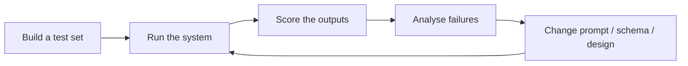

# Evaluation Basics L1–L2

"It worked when I tried it" is not evidence. **Evaluation** means measuring how well your Claude application performs on a representative set of inputs, so you can improve it with confidence.

## Why architects care

Many design questions are really evaluation questions in disguise:

* Is the new prompt **actually** better, or just better on the one example you tried?
* Which fields does extraction get wrong, and on which document types?
* Is it safe to auto-accept, or does this case need human review?

## The basic loop

1. **Test set:** realistic inputs, including edge cases and known-hard cases, each with the expected output. Use fictional or properly anonymised data.
2. **Run** the current version over the whole set.
3. **Score:** exact match where possible (IDs, numbers), rubric-based grading where not (summaries).
4. **Analyse** failures by **field** and by **input type**, not only as one overall number.
5. **Change one thing at a time**, then re-run and compare.

## Kinds of grading

| Method | Good for | Watch out |
|---|---|---|
| **Code-based** (exact match, regex, schema checks) | structured fields, classifications | can't judge free text |
| **Model-based** (Claude grades against a rubric) | summaries, tone, helpfulness | use a clear rubric and an **independent** grader instance |
| **Human review** | high-stakes or ambiguous cases | expensive: target it by risk, not at random |

## Metrics that don't lie

* **Per-field accuracy:** 97% overall can hide a field that's wrong 20% of the time.
* **Per-segment accuracy:** by document type, language, source or channel.
* **Calibration:** when the system says "high confidence", how often is it right? Check against a labelled set before relying on confidence to skip review.

## Check yourself

??? question "A new prompt improves overall accuracy from 92% to 94%, but invoice totals got worse. Ship it?"
    Not without looking closer. The total is likely a **critical** field. Analyse per field and decide by business impact, not the overall number.

??? question "Who should grade free-text summaries in your eval?"
    A rubric-based grader in an **independent** context (another Claude instance with explicit criteria), with periodic human spot checks to keep it honest.

**Verify in official docs:** [Define success criteria and build evaluations](https://docs.claude.com/en/docs/test-and-evaluate/develop-tests)
