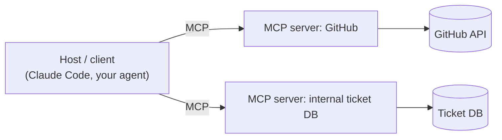

# MCP Basics <span class="level-badge">L1</span>

The **Model Context Protocol (MCP)** is an open standard for connecting AI applications to tools and data. Think of it as *"USB-C for AI tools"*: build an MCP server once, and any MCP-capable client (Claude Code, Claude apps, your own agent built with the Agent SDK) can use it.

## The pieces



An MCP **server** can expose three kinds of things:

| Primitive | What it is | Example |
|---|---|---|
| **Tools** | actions the model can call | `create_issue`, `query_tickets` |
| **Resources** | read-only content the client can show or attach | a catalogue of available docs, a DB schema |
| **Prompts** | reusable prompt templates | "summarise this incident" |

Transports: **stdio** (a local process) and **HTTP** (remote servers; SSE is the older remote transport).

!!! tip "Resources as content catalogues"
    If an agent wastes many tool calls just *discovering* what exists ("which docs are there?"), expose a **resource** that lists what is available. One read replaces a lot of exploratory calls.

## Scopes in Claude Code

| Scope | Stored in | Who gets it | Use for |
|---|---|---|---|
| **local** (default) | `~/.claude.json`, under this project's path | only you, only this project | personal experiments, personal credentials |
| **project** | `.mcp.json` at repo root, committed to Git | everyone who clones the repo | shared team tooling |
| **user** | `~/.claude.json`, top level | only you, all projects | personal tools you use everywhere |

```bash
claude mcp add --scope project --transport http tickets https://mcp.example.internal/mcp
```

When the same server name exists in several scopes: **local > project > user**.

## Secrets: environment variable expansion

Never commit tokens into `.mcp.json`. Reference environment variables instead:

```json
{
  "mcpServers": {
    "github": {
      "type": "http",
      "url": "https://api.githubcopilot.com/mcp/",
      "headers": { "Authorization": "Bearer ${GITHUB_TOKEN}" }
    }
  }
}
```

`${VAR}` and `${VAR:-default}` work in `command`, `args`, `env`, `url` and `headers`.

## Verifying discovery

After adding a server, check it actually connected and its tools are visible (`claude mcp list`, or `/mcp` inside a session). A server that is configured but not discovered is a common "why isn't Claude using my tool?" cause.

Deep dive: [D2 · Tool Design & MCP Integration](../architect/domains/d2-tool-design-mcp.md)
