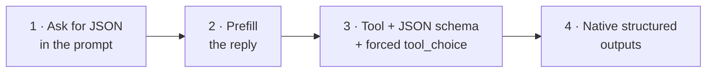

# Structured Output Basics <span class="level-badge">L1</span>

Applications usually need data they can **parse**: JSON with known fields, not free text. There are four ways to get it, from weakest to strongest.

## The ladder



| Level | How | Reliability |
|---|---|---|
| 1 | "Respond only with JSON like {…}" | may add prose or drift |
| 2 | start Claude's reply with `{` | better, still unvalidated |
| 3 | define a tool whose `input_schema` is your schema, force it with `tool_choice` | high, widely supported |
| 4 | `output_config.format` (JSON outputs) or `"strict": true` on tools | schema validity guaranteed |

## Level 3 in code

```python
tool = {
  "name": "record_contact",
  "description": "Record one contact extracted from the text.",
  "input_schema": {
    "type": "object",
    "properties": {
      "name":  {"type": "string"},
      "email": {"type": ["string", "null"], "description": "null if no email is present"},
      "phone": {"type": ["string", "null"]}
    },
    "required": ["name"]
  }
}
resp = client.messages.create(model=MODEL, max_tokens=512, tools=[tool],
    tool_choice={"type": "tool", "name": "record_contact"},
    messages=[{"role": "user", "content": "Contact: Test User, test.user@example.com"}])
data = next(b.input for b in resp.content if b.type == "tool_use")
```

## Three rules that prevent most bugs

1. **Format guarantees are not truth guarantees.** Valid JSON can still contain wrong or invented values.
2. **Don't make fields required unless every input has them.** Use nullable types and "unknown" enum values so the model never has to guess.
3. **Validate anyway.** Check business rules (dates, totals, IDs) in code, and retry with the specific error, but never retry to "find" missing data.

Deep dive: [D4 · Prompt Engineering & Structured Output](../architect/domains/d4-prompt-structured-output.md)

**Verify in official docs:** [Structured outputs](https://platform.claude.com/docs/en/build-with-claude/structured-outputs)
