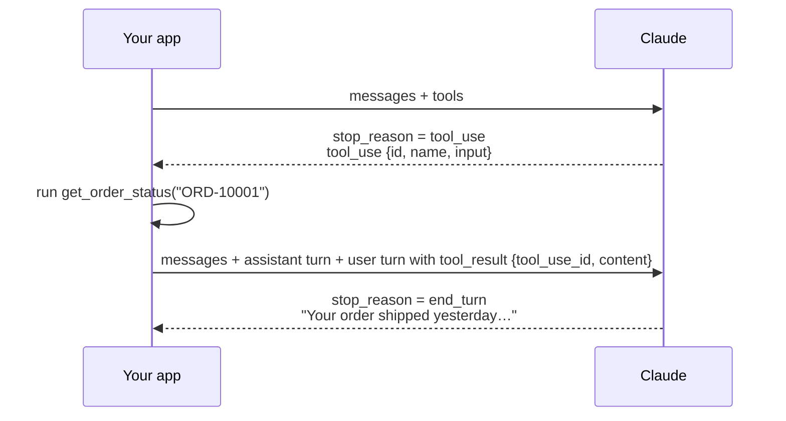

# Tool Use Basics <span class="level-badge">L1</span>

**Tools** let Claude ask *your code* to do things: look up an order, query a database, call an API. Claude never runs the tool itself. It *requests* the call, your code runs it, and you send back the result.

## 1. Define a tool

```python
tools = [{
    "name": "get_order_status",
    "description": (
        "Look up the current shipping status of ONE order by its order ID. "
        "Use when the customer asks where their order is. "
        "Do NOT use for refunds; use process_refund instead. "
        "Input: order_id like 'ORD-12345'."
    ),
    "input_schema": {
        "type": "object",
        "properties": {
            "order_id": {"type": "string", "description": "Format ORD-#####"}
        },
        "required": ["order_id"]
    }
}]
```

The **description is the main thing Claude uses to decide which tool to call**. Write it like documentation for a new teammate: what it does, when to use it, when *not* to, and the input format.

## 2. The round trip



The `tool_result` goes inside a **user** message and must reference the `tool_use_id`. If the tool failed, send the result with `"is_error": true` and a helpful message, so Claude can recover instead of guessing.

## 3. Controlling tool use with `tool_choice`

| `tool_choice` | Behaviour | Typical use |
|---|---|---|
| `{"type": "auto"}` | Claude decides whether to call a tool (default when tools are given) | normal assistants and agents |
| `{"type": "any"}` | Claude **must** call *some* tool | every reply must be an action or a structured record |
| `{"type": "tool", "name": "X"}` | Claude **must** call tool **X** | guaranteed structured output; forcing a prerequisite step first |
| `{"type": "none"}` | Claude may not call tools | a text-only turn |

Key facts:

* With `any` or `tool`, the API **prefills** the assistant turn to force a tool call, so Claude will not write explanatory text before the `tool_use` block.
* With manually enabled **extended thinking**, only `auto` and `none` are supported.
* `disable_parallel_tool_use: true` limits Claude to *at most one* tool call (with `auto`) or *exactly one* (with `any` or `tool`).

!!! tip "Exam pattern"
    "Downstream code crashes when Claude replies conversationally instead of calling the extraction tool." → Set `tool_choice` to force that tool. A prompt instruction is *not* a guarantee.

## Check yourself

??? question "Two tools, `search_kb` and `search_tickets`, keep getting confused. First fix?"
    Expand both **descriptions** with clear use-cases, input formats and explicit "use X instead when…" guidance. Descriptions are the primary selection signal.

??? question "Your tool hit a timeout. What should you send back to Claude?"
    A `tool_result` with `is_error: true` and structured detail (for example: error type *transient*, retryable *yes*, suggested action *retry in 5 s*), not an empty string and not a fake success.
