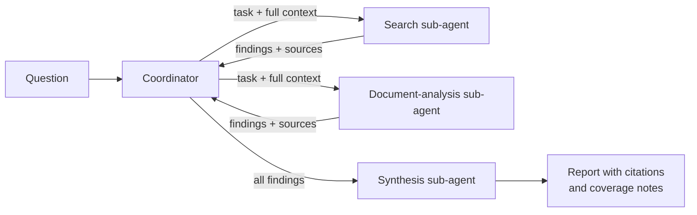

# Lab 4 · Design and Debug a Multi-Agent Research Pipeline <span class="level-badge">L3</span>

**Goal:** build a small coordinator-and-sub-agents system, then break it on purpose and fix it. This is the fourth kind of hands-on practice the official Architect exam guide recommends; Labs 1–3 cover the other three.

**Domains:** D1, D2, D5 · **Time:** 2–3 hours · **You need:** Python, the Claude Agent SDK (or your own loop from [Lab 1](lab-01-agentic-loop.md)), an API key.

!!! note "A build-it-yourself lab"
    Unlike Labs 1–3 there is no ready-made script. Designing the hand-offs yourself is the point. Use only **fictional topics and sources** (for example, two made-up reports about a made-up product).

## What you will build



## Step 1 · Coordinator and two sub-agents

* Give the coordinator permission to delegate (its allowed tools must include the sub-agent tool) and **nothing else it doesn't need**.
* Define each sub-agent with a description, its own instructions and a small tool set.
* In each delegation, **write everything the sub-agent needs into the task itself**: the question, the scope, the output format. It cannot see the coordinator's conversation.

**Check:** remove the topic from a delegation message and confirm the sub-agent returns something generic. That is the inheritance mistake, seen first-hand.

## Step 2 · Run sub-agents in parallel

Have the coordinator issue both delegations in **one** turn, then compare the elapsed time with running them one after the other.

**Check:** you can explain why two calls in one response run concurrently and two calls in two turns do not.

## Step 3 · Structured findings with provenance

Make every sub-agent return findings in one shape:

```json
{
  "claim": "Battery life improved in the second model",
  "evidence": "short excerpt supporting the claim",
  "source": "fictional-report-a.pdf, page 4",
  "published": "2026-03-01"
}
```

**Check:** the final report can point to a source and date for every claim. If a summary step loses them, fix the hand-off format, not the prompt wording.

## Step 4 · Break it: a sub-agent times out

Simulate a failure in the search sub-agent. It must return a **structured error**, not an empty success:

```json
{
  "status": "error",
  "failure_type": "timeout",
  "attempted": "search for second-model battery tests",
  "partial_results": [],
  "retryable": true
}
```

**Checks:**

* The coordinator can tell "search failed" from "search found nothing".
* The run continues with the other sub-agent's results.
* The final report says which area is not covered, and why.

## Step 5 · Break it: sources disagree

Give the two sub-agents sources with different figures for the same fact.

**Checks:**

* The report shows **both** figures with their sources and dates. It does not silently choose one.
* The report separates well-supported findings from contested ones.
* If the dates differ, the report says the difference may be a change over time, not a contradiction.

## Step 6 · Narrow the tools

Give the synthesis sub-agent a search tool it doesn't need and watch whether it starts searching instead of synthesising. Then remove it.

**Check:** you can state the rule: each agent gets the tools its role needs, and no more.

## What you should be able to explain afterwards

- [ ] Why sub-agent context must be passed explicitly
- [ ] How parallel delegation works and when it helps
- [ ] Why hand-offs carry sources and dates as structured data
- [ ] The difference between an access failure and a valid empty result
- [ ] How a coordinator proceeds with partial results and reports the gap
- [ ] How to present conflicting sources honestly

**Read next:** [D1 · Agentic Architecture](../architect/domains/d1-agentic-architecture.md) · [D5 · Context & Reliability](../architect/domains/d5-context-reliability.md)
