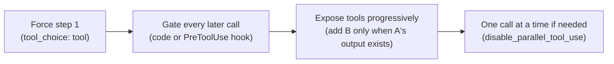

# Forcing and ordering tool calls: a field guide

Prasoon Abhinaw · November 2026 · 6-minute read

Most people learn `tool_choice` early. Far fewer learn how to make tools run **in the right order**, and that's where many real-world agent bugs live. Here's the complete toolkit in one place.

## Part 1: making a tool call happen

| `tool_choice` | What it means | Use it when |
|---|---|---|
| `auto` (default) | Claude decides whether to call a tool | normal assistants and agents |
| `any` | Claude **must** call some tool | every reply must be an action or a record |
| `tool` + name | Claude **must** call that tool | structured output; a mandatory first step |
| `none` | no tools this turn | a text-only turn |

Two details worth remembering:

* With `any` or a named `tool`, the turn is prefilled to force the call, so Claude won't write explanatory text before it.
* With manually enabled extended thinking, only `auto` and `none` are supported. Forcing isn't available there, so ordering has to be enforced in code (see Part 2).

## Part 2: making tools run in order

Forcing controls **one request**. Ordering is a property of the **whole session**. So you need more than `tool_choice`.

1. **Force the first step** when skipping it is the most common failure.
2. **Gate every dependent tool.** If B is called before A has succeeded, return a structured *precondition* error: `{"error_category": "precondition", "is_retryable": true, "suggested_action": "Call A first"}`. Claude reads it and self-corrects.
3. **Expose tools progressively.** A tool that isn't offered yet can't be called too early.
4. **Disable parallel calls** when B needs A's output, since Claude may otherwise request both in the same turn.

## A quick decision table

| Symptom | First fix |
|---|---|
| Parser crashes on a prose reply | Force the tool (`tool_choice: tool`) |
| Step 1 is sometimes skipped | Force step 1 on the first turn |
| Steps run out of order later in long chats | Gate dependent tools in code |
| A and B requested together | `disable_parallel_tool_use` plus a gate |
| Extended thinking is on | Keep `auto` and enforce the order in code |

## The common mistake

Writing "always call get_customer first" in the system prompt, or listing tools in the "right" order in the `tools` array. Neither enforces anything: the array order has no meaning, and prompt rules are guidance.

## Go deeper

* [D2 · tool_choice and tool sequencing](../architect/domains/d2-tool-design-mcp.md#tool_choice-and-tool-sequencing)
* [Commonly Missed Topics #1](../architect/commonly-missed.md#1-tool_choice-sequencing)
* [Question bank · D2](../architect/question-bank/d2.md)
