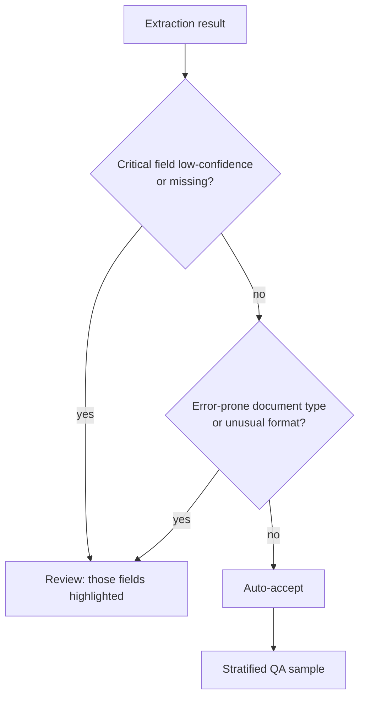

# Human review that isn't random

Prasoon Abhinaw · November 2026 · 5-minute read

"We review a random 5% of documents" sounds responsible. In practice it often means reviewers spend their day confirming easy cases while the risky ones slip through. Here's a better way to design the human step in an extraction pipeline.

## Why random sampling disappoints

Imagine a pipeline with **98% overall accuracy**. Good, right? Now split it by field and document type:

| Field | Digital invoices | Scanned forms |
|---|---|---|
| Invoice number | 99.8% | 99.1% |
| Total | 99.5% | 97.9% |
| **Bank account** | 99.6% | **85.0%** |

*(Illustrative numbers.)* A random 5% sample barely touches the scanned forms, and almost never lands on the one field that matters most. The average hid the problem.

## Route by risk instead

Four building blocks:

1. **Field-level confidence**, returned with each extracted value, and **calibrated** against a labelled sample before anyone trusts it.
2. **Critical fields** (bank details, totals, IDs) get stricter thresholds than nice-to-have fields.
3. **Document characteristics** such as scan quality, new templates and handwriting raise the review rate for that segment.
4. **Stratified sampling** of auto-accepted items: sample *within* each document type and confidence band, so rare segments are still checked, and use the results to recalibrate.

## Make the reviewer's job small

Show reviewers **which fields** were flagged and **why**, instead of the whole document with no hints. Targeted review is faster and catches more.

## The measurement habit

Before writing any review rule, build the **per-field, per-document-type accuracy table** from a labelled sample. It almost always shows that a few fields on a few document types cause most of the risk. That's where human attention pays off.

## Go deeper

* [D5 · Human review routing](../architect/domains/d5-context-reliability.md#human-review-routing)
* [D4 · Schema design that prevents fabrication](../architect/domains/d4-prompt-structured-output.md#schema-design-that-prevents-fabrication)
* [Lab 2 · Reliable Structured Extraction](../labs/lab-02-structured-extraction.md)
