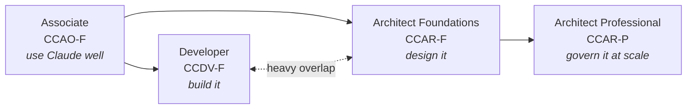

# The Four Claude Certifications L1

Anthropic launched its first technical certification, **Claude Certified Architect – Foundations**, on **12 March 2026**, alongside the Claude Partner Network. As of mid-2026 the programme has **four** proctored exams.

| Certification | Code | For | Approx. price (USD) |
|---|---|---|---|
| Claude Certified Associate – Foundations | CCAO-F | Consultants, sellers, delivery leads who *use* Claude in their work | $99 |
| Claude Certified Developer – Foundations | CCDV-F | Engineers *building* with the Claude API, Claude Code and MCP | $125 |
| **Claude Certified Architect – Foundations** | **CCAR-F** (formerly CCA-F) | Solution architects *designing* production Claude systems | $125 |
| Claude Certified Architect – Professional | CCAR-P | Senior architects, enterprise scale, governance, lifecycle | $175 |

Prices are list prices before any partner-tier discount. Always confirm on the official Anthropic Partner Academy page, because they can change.

## How the exams differ

* **Architect (CCAR-F)** asks *"which design is best and why?"* It has 60 scenario-based questions in 120 minutes, and the questions are grouped under 4 of 6 published business scenarios.
* **Developer (CCDV-F)** asks *"how exactly do you build it?"* It has 53 questions in 120 minutes, with heavier weight on API mechanics, application design, model selection and cost.
* The two share a lot of ground (agents, tools, MCP, prompting, context). That is why this hub teaches **Architect first, then Developer**: the design reasoning you learn for CCAR-F makes CCDV-F much faster.

## Which should I take first?

* **You design systems or lead technical decisions** → Architect (CCAR-F).
* **You mainly write the code** → Developer (CCDV-F) is fine first, but the Architect domain pages here are still the best preparation for its *Agents*, *Tools* and *Prompt/Context* domains.
* **You are not technical** → Associate (CCAO-F).

## Registration basics

* Register through **Anthropic's Partner Academy** (Skilljar). Delivery is online-proctored.
* Passing score is **720 on a 100–1000 scale** for both Foundations technical exams.
* Credentials are valid for **12 months**.
* There are no formal prerequisites, but around **six months of hands-on experience** with the Claude API, Agent SDK, Claude Code and MCP is the recommended baseline.

!!! warning "Check before you book"
    Eligibility (for example partner-organisation access), pricing and retake rules are set by Anthropic and may change. See [Official Links](../resources/official-links.md).
