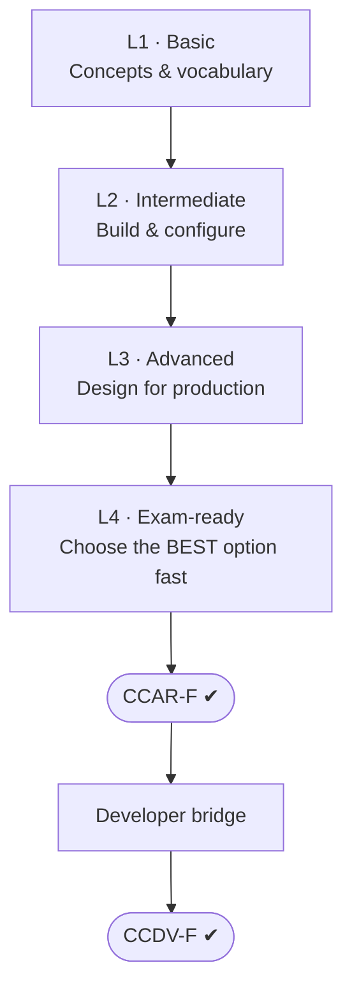

# Learning Roadmap: Basic → Exam-ready

Follow the levels in order. Each one ends with a **milestone**: a thing you can *do*, not just read.

## L1 · Basic (about 1 week)

- [ ] [LLM & Claude Basics](../fundamentals/llm-basics.md): tokens, context window, model families
- [ ] [The Messages API](../fundamentals/messages-api.md): roles, statelessness, `stop_reason`
- [ ] [Prompt Engineering Basics](../fundamentals/prompt-engineering-basics.md): clear, structured prompts
- [ ] [Tool Use Basics](../fundamentals/tool-use-basics.md): `tool_use` → `tool_result` round trip
- [ ] [Structured Output Basics](../fundamentals/structured-output-basics.md) and [Agent SDK Basics](../fundamentals/agent-sdk-basics.md)
- [ ] [Claude Code Basics](../fundamentals/claude-code-basics.md), [MCP Basics](../fundamentals/mcp-basics.md) and [Evaluation Basics](../fundamentals/evaluation-basics.md)

**Milestone:** explain to a colleague, without notes, why you must resend the conversation history on every API call.

## L2 · Intermediate (about 1–2 weeks)

- [ ] [Lab 1 · Build an Agentic Loop](../labs/lab-01-agentic-loop.md)
- [ ] [Lab 3 · Configure Claude Code for a Team](../labs/lab-03-claude-code-config.md)
- [ ] Read the "Core concepts" sections of all five [Architect domains](../architect/index.md)

**Milestone:** a working script where Claude calls two tools in the right order, and a repo with `CLAUDE.md`, one rule file, one custom command and one hook.

## L3 · Advanced (about 2 weeks)

- [ ] Full domain deep-dives, including the *anti-patterns* and *trade-offs* sections
- [ ] [Lab 2 · Reliable Structured Extraction](../labs/lab-02-structured-extraction.md)
- [ ] [The Six Scenarios](../architect/scenarios.md): sketch an architecture for each

**Milestone:** for each scenario, name the main failure risk and the mechanism that prevents it.

## L4 · Exam-ready (about 1 week)

- [ ] [Practice Questions](../architect/practice-questions.md): aim for 85% or higher, and review *every* explanation
- [ ] [Commonly Missed Topics](../architect/commonly-missed.md)
- [ ] [Cheat Sheet](../architect/cheat-sheet.md) the day before
- [ ] [Exam Day Guide](../architect/exam-day.md)

**Milestone:** you can say *why each wrong option is wrong*, not just which one is right.

## After CCAR-F → CCDV-F

Go to [Architect → Developer Bridge](../developer/bridge-from-architect.md). It lists exactly what is new (API mechanics, model selection, cost/token management, security) and what you can skip because you already know it.
